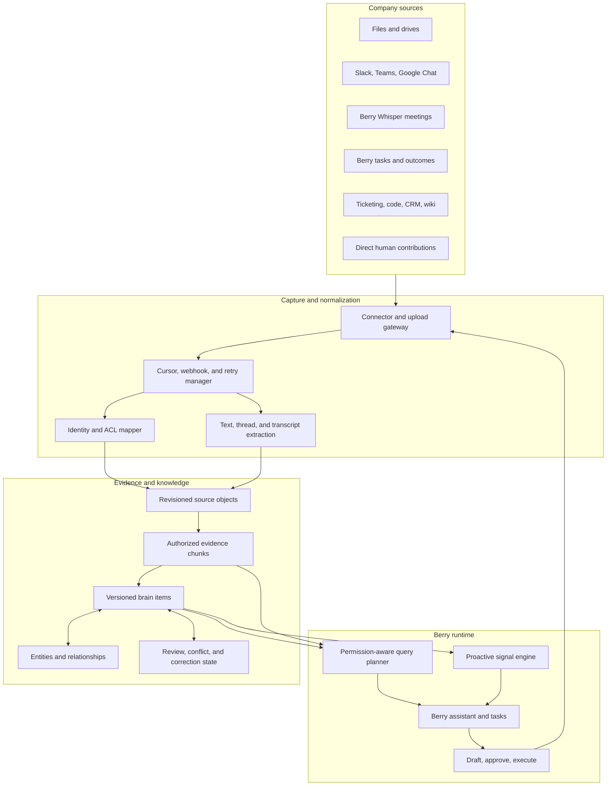
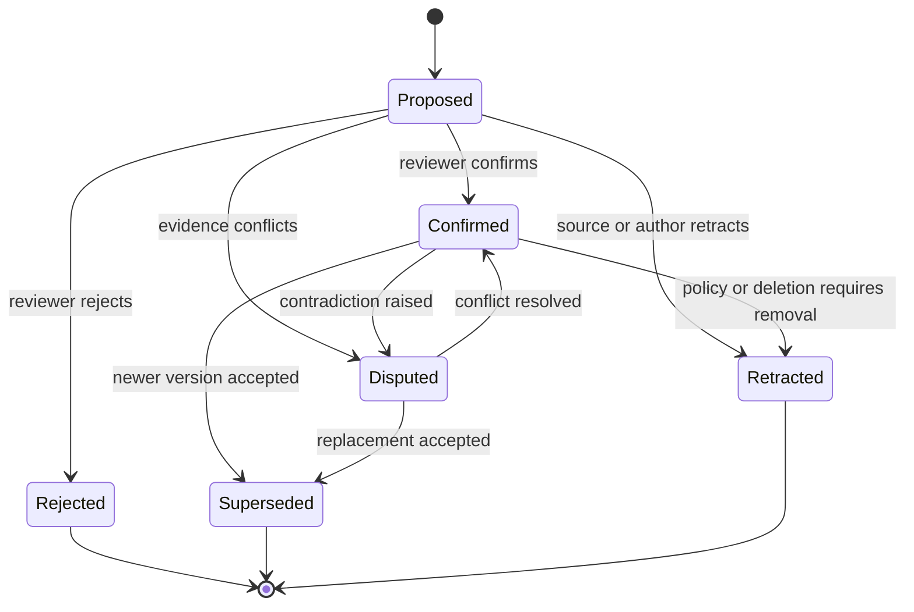
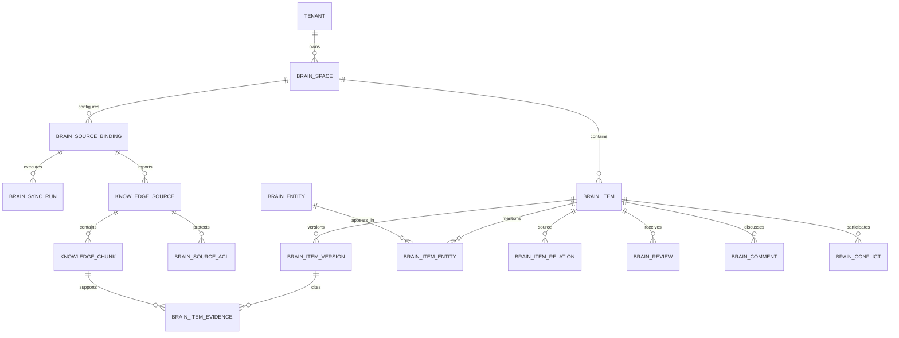
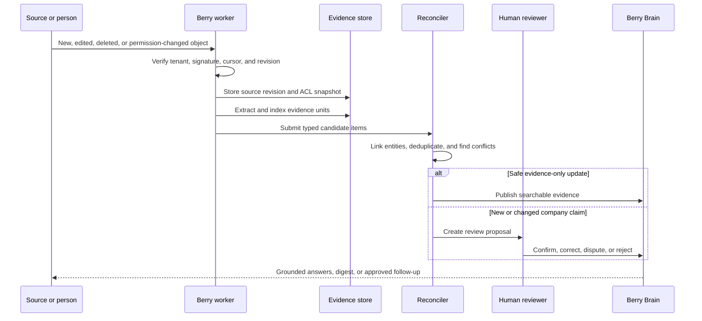
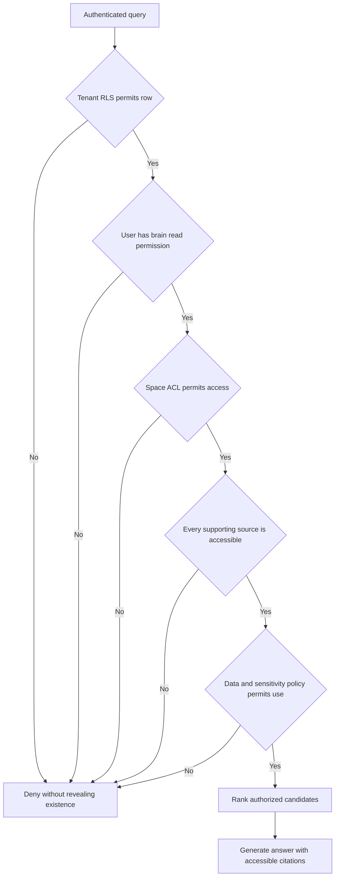
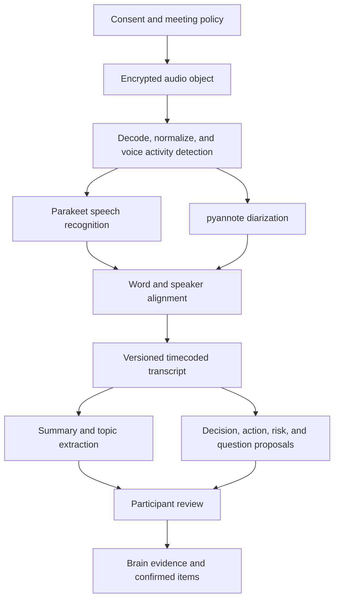
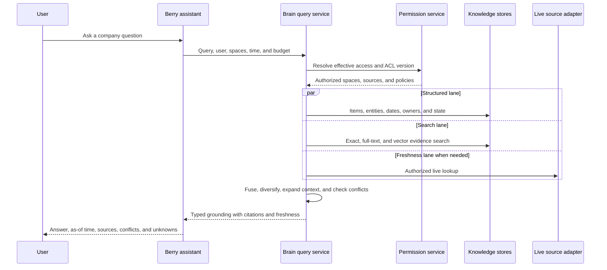

# Berry Brain: Multiplayer Company Intelligence Architecture

Status: **PROPOSED**
Owner: Product, platform, AI, and enterprise security
Last updated: 2026-09-03

## Decision

Build the company brain as a permission-aware knowledge layer inside Berry, not
as a separate chatbot and not as a second application stack.

Berry already has the important foundations: tenants, departments, roles,
resource ACLs, encrypted connectors, files, object storage, extraction,
pgvector, hybrid retrieval, citations, versioned memory, durable turns, an
outbox, and BullMQ workers. The new feature should extend these systems with:

1. Shared brain spaces for an organization, department, team, or project.
2. Revisioned source evidence with source-native permissions.
3. Versioned knowledge items such as facts, decisions, policies, goals, risks,
   questions, meeting summaries, and action items.
4. A review and correction loop that makes learning attributable and safe.
5. A small, stable set of brain tools available to every Berry assistant.
6. Berry Whisper for meeting transcription, diarization, summaries, decisions,
   and follow-ups.
7. Proactive signals for contradictions, stale knowledge, blockers, and missing
   follow-through, with human approval before external actions.

The central rule is:

> Berry may index source evidence automatically. It must not silently turn every
> model inference into company truth.

## Product promise

Berry Brain gives every authorized employee a shared, living understanding of
the company. A person can ask what the company knows, see where the answer came
from, correct it, add context, and turn it into accountable work.

It should answer questions such as:

- What did we decide about enterprise pricing, when, and who was involved?
- Why did the onboarding launch move to October?
- What promises have we made to this customer?
- Which risks appeared in meetings this month but have no owner?
- Does the current plan contradict an earlier policy or decision?
- What changed in the Acme account since the last leadership meeting?

## What “keeps learning” means

Learning is a controlled data lifecycle, not model fine-tuning.

1. **Capture:** receive documents, messages, meetings, task outcomes, and direct
   contributions.
2. **Understand:** extract searchable evidence and typed candidate knowledge.
3. **Connect:** link people, teams, projects, customers, products, decisions,
   and actions.
4. **Reconcile:** merge duplicates, retain history, and surface contradictions.
5. **Review:** let people confirm, correct, dispute, or retract knowledge.
6. **Use:** ground chat answers, briefs, project work, and approved actions.
7. **Refresh:** react to edits, deletes, permission changes, and newer evidence.

This creates compounding value without hiding where any claim originated.

## Product model

The product has four simple verbs.

| Verb | User experience | System behavior |
|---|---|---|
| Ask | Ask Berry a company question from chat or the Brain page. | Search authorized knowledge and evidence, then answer with citations and an “as of” time. |
| Teach | Select **Add to Brain**, write a correction, or confirm a proposal. | Create an attributable, versioned knowledge item or review. |
| Discover | See new decisions, unresolved contradictions, stale policies, and ownerless work. | Run governed background detectors and prepare quiet, relevant signals. |
| Act | Convert a decision or action item into a ticket, message, or task. | Draft a typed operation, request approval when required, execute it through an authorized connector, and audit the result. |

### Primary users

- **Member:** asks questions, browses evidence, contributes context, and comments.
- **Reviewer:** confirms or disputes proposed knowledge in assigned spaces.
- **Source manager:** connects approved company systems and controls sync scope.
- **Brain administrator:** manages spaces, policies, retention, reviewers, and
  organization-wide visibility.
- **Auditor:** inspects provenance, permission decisions, changes, and actions
  without receiving access to source content they could not otherwise read.

### Multiplayer means

- Knowledge belongs to a shared space rather than one user’s memory.
- Every contribution has an author and version history.
- Reviewers can discuss, confirm, dispute, and supersede items.
- Users see updates, comments, and review-state changes promptly.
- Simultaneous edits use optimistic version checks in the first release.
- Live co-editing with a CRDT is deferred until users need collaborative long-
  form pages often enough to justify its operational cost.

## Goals and non-goals

### Goals

- Make company knowledge searchable from every Berry conversation.
- Preserve evidence, time, authorship, and revision history.
- Enforce tenant, space, and source permissions before ranking or generation.
- Learn from explicit contributions, connected sources, meetings, and Berry
  work products.
- Represent change and disagreement instead of overwriting history.
- Support self-hosted deployment with the existing Berry platform.
- Degrade safely when a connector, embedding model, or transcription worker is
  unavailable.

### Non-goals for the first release

- Training a tenant-specific foundation model.
- Ingesting every company system by default.
- Reading private direct messages or email without an explicit policy and
  narrow authorization.
- A general workflow builder.
- Fully autonomous writes to chat, ticketing, CRM, or source documents.
- A dedicated graph database.
- Google-Docs-style simultaneous page editing.
- Treating an unreviewed summary as an authoritative company decision.

## What Berry already has

| Existing Berry capability | Reuse | Required extension |
|---|---|---|
| Tenants, memberships, departments, roles, and resource ACLs | Keep as the control plane. | Add brain permissions, explicit default-deny space rules, external identity mapping, and source ACL snapshots. |
| `memory_items` and memory versions | Keep personal and project memory behavior. | Do not turn user-owned memory into company truth. Add a separate shared item lifecycle. |
| `knowledge_sources`, `knowledge_chunks`, pgvector, full-text search, reciprocal-rank fusion, and retrieval snapshots | Reuse extraction, chunking, embedding, ranking, citations, and replay. | Add brain-space scope, source-object revisions, source ACL filtering, temporal fields, and item retrieval. |
| Files, S3-compatible object storage, derivatives, and Tika | Reuse for documents, audio, transcripts, and extracted text. | Add retention classes, meeting artifacts, and source-revision lineage. |
| Organization connectors and encrypted personal/shared credentials | Reuse authorization, secret envelopes, approval, and connector administration. | Add durable sync bindings, cursors, webhook intake, ACL mirroring, and connector health. |
| Durable turns and grounding context | Reuse for reproducible agent runs. | Add typed company facts, evidence citations, freshness, conflict state, and ACL version to the snapshot. |
| Outbox, Redis, and BullMQ workers | Reuse for idempotent asynchronous work. | Add connector sync, knowledge reconciliation, conflict detection, and meeting jobs. |
| Audit, budgets, guardrails, and tool approvals | Reuse for governance. | Audit every brain mutation and every proposed or completed external action. |

### The main gaps

Current knowledge is primarily attached to a user or workspace. Current project
memory also remains user-owned. Connector imports are useful in a task, but do
not yet form a continuously synchronized, organization-level knowledge system.
There is no first-class lifecycle for a shared fact, decision, conflict,
review, correction, or external-source ACL.

## Design principles

1. **Evidence before inference.** Store the source revision before deriving a
   fact or decision from it.
2. **Permissions before relevance.** Filter unauthorized candidates before
   lexical search, vector scoring, counts, aggregation, or generation.
3. **History instead of overwrite.** New information supersedes an old version;
   it does not erase what the company believed at the time.
4. **Humans establish authority.** Model confidence helps route reviews. It is
   not permission to declare truth.
5. **Personal memory stays personal.** Shared company knowledge has different
   ownership, review, retention, and disclosure rules.
6. **Typed operations over free-form writes.** Models propose validated changes;
   application services enforce them.
7. **One stable brain interface.** Source-specific behavior stays behind
   adapters so the assistant does not receive dozens of overlapping tools.
8. **Self-hosted first.** Postgres, pgvector, object storage, Redis, and workers
   remain the default architecture.
9. **Quiet by default.** Proactive insights appear only when useful, actionable,
   and allowed by notification policy.

## High-level architecture



### Runtime shape

- Keep the Brain control plane and query API inside `apps/api`.
- Keep ingestion, extraction, embedding, reconciliation, and detectors inside
  `apps/worker`.
- Reuse Postgres with pgvector as the system of record and search store.
- Reuse object storage for raw files, audio, transcripts, and derivatives.
- Reuse Redis and BullMQ for queues, locks, rate limits, and short-lived caches.
- Add `apps/whisper` as an optional Python inference service for GPU-oriented
  speech recognition and diarization. It does not own permissions or company
  knowledge.
- Do not create a separate Brain microservice in the first release. That would
  duplicate authentication, authorization, persistence, and operations before
  scale proves the need.

## The knowledge model

The brain separates four layers that are often incorrectly collapsed into a
single vector index.

| Layer | Meaning | Example |
|---|---|---|
| Source object | A precise external object and revision. | Slack thread revision, Drive document revision, meeting recording, Berry task outcome. |
| Evidence unit | A searchable, addressable part of that revision. | Paragraph, message with thread context, transcript segment with speaker and timecode. |
| Brain item | A versioned interpretation useful to the company. | Decision, policy, fact, goal, risk, question, action, or summary. |
| Curated view | A human-owned synthesis of many items. | Account brief, product strategy page, project timeline, weekly digest. |

An answer can quote evidence directly without creating a brain item. A brain
item must always preserve its supporting evidence unless it is explicitly
human-authored, in which case the author is the primary provenance.

### Brain spaces

A `brain_space` is the product and security boundary for shared knowledge.

Supported kinds:

- `organization`
- `department`
- `team`
- `project`

Each tenant receives one organization space. Administrators can create narrower
spaces and bind sources to them. A source may feed more than one space only when
its ACL policy explicitly permits that exposure.

### Brain item kinds

Use one versioned item model with typed `kind` and validated `structured_data`:

- `fact`
- `decision`
- `policy`
- `goal`
- `risk`
- `question`
- `action`
- `summary`
- `page`

Common columns remain queryable: owner, status, confidence band, sensitivity,
validity interval, observed time, due date, and review state. Type-specific data
is validated with shared Zod schemas before persistence.

### Lifecycle



Do not show a raw model probability as truth in the UI. Show understandable
states: **Confirmed**, **Needs review**, **Disputed**, **Superseded**, and
**Evidence unavailable**. Internal confidence may combine extraction quality,
source authority, corroboration, freshness, and human review.

### Proposed database model



### New tables

| Table | Purpose | Important fields |
|---|---|---|
| `brain_spaces` | Shared scope and policy boundary. | `tenant_id`, `kind`, `name`, `slug`, `default_visibility`, `retention_policy_id`, `status` |
| `brain_source_bindings` | A configured external scope to synchronize. | `tenant_id`, `space_id`, `connector_id`, `connection_id`, `external_scope`, `sync_mode`, `cursor`, `last_success_at`, `acl_state` |
| `brain_sync_runs` | Observable, retryable sync history. | binding, trigger, cursor before/after, counts, status, error class, timestamps |
| `brain_source_acl_entries` | Snapshot of source-native access. | source, external principal, mapped Berry principal, allow/deny, observed time, ACL hash |
| `brain_external_principals` | Mapping from external users/groups to Berry identities. | provider, external ID, principal type, Berry user/department/role, resolution state |
| `brain_items` | Stable identity for a shared knowledge item. | space, kind, stable key, current version, lifecycle state, owner, sensitivity |
| `brain_item_versions` | Immutable content and structured values. | item, version, title, content, structured data, confidence band, valid from/to, created by/type |
| `brain_item_evidence` | Version-specific provenance. | item version, source, chunk, locator, support type, extraction run |
| `brain_entities` | Canonical people, teams, projects, customers, products, and topics. | space, type, canonical name, external refs, status |
| `brain_entity_aliases` | Name and identifier resolution. | entity, alias, source, normalized alias |
| `brain_item_entities` | Typed item-to-entity links. | item, entity, role such as subject, owner, customer, or participant |
| `brain_item_relations` | Lightweight knowledge graph edges. | source item, target item, relation type, evidence, valid from/to |
| `brain_reviews` | Confirm, reject, dispute, or request changes. | item, version, reviewer, verdict, note, timestamp |
| `brain_comments` | Human discussion and mentions. | item, author, body, parent, timestamps |
| `brain_conflicts` | Explicit contradiction workflow. | left item, right item, reason, status, resolution, resolver |
| `brain_activity_events` | Product activity feed and notification source. | actor, space, event type, object, audience, payload, created time |

Every new table carries `tenant_id`, row-level security, timestamps, and an
auditable actor. Cross-table references must either include tenant identity or
be checked in the service transaction so an ID from another tenant can never be
attached accidentally.

### Extending the existing knowledge tables

Do not build a duplicate document pipeline. Extend `knowledge_sources` and
`knowledge_chunks` additively:

- Add nullable `brain_space_id` and make `workspace_id` nullable.
- Add a database check requiring exactly one owning scope: workspace or brain
  space.
- Add `source_binding_id`, `external_id`, `external_revision`, `external_url`,
  `source_updated_at`, and `source_acl_hash` to brain-scoped sources.
- Add `brain_space_id` to chunks for efficient authorized filtering.
- Add source types for synchronized objects, meeting transcripts, brain pages,
  and reviewed items.
- Preserve content hash, embedding version, tombstones, authority, and existing
  retrieval snapshots.
- Backfill current rows as workspace-scoped before enforcing the check.

This lets the current Tika, chunking, embedding, full-text, vector, deletion,
reindex, and citation paths continue to work.

### Why Postgres is enough initially

The first valuable graph queries are bounded: items related to an entity,
decision history, supporting evidence, supersession, ownership, and one or two
relationship hops. Postgres adjacency tables, recursive CTEs, full-text search,
and pgvector can handle these while preserving RLS and transactional updates.

Reconsider a graph database only if measured workloads require deep path
traversal that cannot meet latency targets. Adding one earlier would create a
second permission and consistency system.

## The learning loop



### Candidate extraction

The model receives bounded evidence and returns only a typed schema. It may
propose items, entities, relations, and action owners. It cannot write arbitrary
SQL, create tables, select an ACL, or execute a connector action.

Validate every candidate for:

- allowed kind and fields;
- evidence locators that belong to the same tenant and authorized space;
- dates, owners, and external identifiers;
- secret and sensitive-data policy;
- maximum content and batch size;
- prompt-injection markers or attempted instructions;
- duplicate stable keys and likely semantic duplicates.

### Reconciliation rules

1. Exact stable-key matches create a proposed new version.
2. High-similarity candidates with the same entities and time window are merged
   into one review proposal.
3. Compatible evidence may corroborate an item and improve its confidence band.
4. Incompatible evidence creates a conflict; it never silently replaces a
   confirmed item.
5. A newer effective policy may supersede an older policy while preserving both
   validity intervals.
6. Human-confirmed content cannot be overwritten by automatic extraction.
7. A source edit reruns only candidates derived from the affected revision.
8. A source deletion or access revocation removes it from retrieval immediately
   and marks dependent items for reevaluation.

### Publication policy

Recommended default:

- Raw authorized evidence becomes searchable after successful indexing.
- Direct human contributions enter as **Confirmed** when the author has write
  permission, with the author as provenance.
- Extracted facts, decisions, policies, and actions enter as **Needs review**.
- Deterministic metadata such as file title, message author, timestamp, or
  ticket status may publish automatically.
- Tenant administrators may enable auto-confirmation for a narrow item kind and
  trusted source, but the audit trail and rollback remain mandatory.

## Permission model

Company knowledge can leak through search counts, summaries, related-item
links, embeddings, notifications, and caches—not only through source text.
Authorization must therefore happen before retrieval and aggregation.

### New organization permissions

- `brain:read`
- `brain:write`
- `brain:review`
- `brain:admin`

Source connection management also requires the existing connector permissions.
External actions require both the relevant connector permission and the
existing approval policy.

### Authorization decision



### Rules

- Brain spaces and synchronized sources are explicit default-deny resources.
  They must not inherit a generic “no matching ACL means allowed” behavior.
- Effective access is the intersection of tenant membership, role permission,
  space ACL, source-object ACL, connector policy, and sensitivity policy.
- A derived item inherits the intersection of all supporting evidence ACLs, not
  their union.
- To share a safe summary more broadly, a reviewer creates a separate curated
  item with its own deliberate visibility and wording.
- Unmapped external identities never become authorization principals.
- Deny entries override allows.
- ACL version is included in query and grounding snapshots.
- Retrieval caches are keyed by tenant, effective principal set, space, policy
  version, and ACL version. Shared cross-user result caches are forbidden.
- Filtering occurs in SQL before full-text/vector ranking. Post-filtering a
  global nearest-neighbor result is both unsafe and low quality.
- Search suggestions, result counts, entity relationships, proactive alerts,
  and audit views follow the same content permission.
- When ACL freshness is unknown after a provider error, the affected source is
  unavailable until access is revalidated.

### Permission changes and deletion

ACL and deletion events use a high-priority queue. Berry first marks affected
sources unavailable, invalidates caches and retrieval snapshots, then performs
slower reindexing or cleanup. A missed webhook is repaired by periodic
reconciliation.

When the last usable evidence for an extracted item disappears, the item becomes
**Evidence unavailable** and is excluded from normal grounding. Retention policy
decides whether its audit metadata may remain. A human-authored item can remain,
but must no longer cite unavailable content.

## Source and connector architecture

### Stable adapter contract

Each provider implements the same narrow application-owned contract:

```ts
interface BrainSourceAdapter {
  listScopes(input: AuthorizedConnection): Promise<SourceScope[]>;
  bootstrap(input: SyncBinding): AsyncIterable<SourceChange>;
  pollChanges(input: SyncCursor): Promise<ChangePage>;
  handleWebhook(input: VerifiedWebhook): Promise<SourceChange[]>;
  fetchObject(input: SourceRef): Promise<SourceObject>;
  fetchAcl(input: SourceRef): Promise<SourceAclSnapshot>;
  expandContext(input: EvidenceRef): Promise<EvidenceContext>;
  resolvePrincipal(input: ExternalPrincipalRef): Promise<IdentityResolution>;
  health(input: AuthorizedConnection): Promise<ConnectorHealth>;
}
```

The assistant sees Berry Brain tools, not provider-specific tool collections.
Adapters own pagination, rate limits, thread expansion, revision IDs, URLs,
membership mapping, and source-specific errors.

### Sync behavior

- A webhook is a change hint, not trusted source content. The worker fetches the
  authoritative object and ACL using the stored connection.
- Each binding has one leased cursor. Jobs are idempotent by tenant, binding,
  external object ID, and external revision.
- Bootstrap and incremental sync use the same object-normalization path.
- Edits create revisions; deletes create tombstones; restored objects create a
  new revision.
- ACL changes are processed ahead of content changes.
- Content hashes prevent duplicate extraction and embedding.
- Failed objects move to a bounded retry schedule and then a visible dead-letter
  state without blocking the entire connector.
- Backfills are rate-limited and resumable.
- Administrators can pause a binding, test access, inspect lag, retry failures,
  and remove synchronized data.

### Integration plan

| Source | Initial capture | Permission boundary | Important behavior |
|---|---|---|---|
| Berry tasks | Final outcomes, selected messages, files, and explicit **Add to Brain** actions | Existing task/workspace access plus target brain-space ACL | Do not ingest every private draft or chain-of-thought-like runtime record. |
| Google Drive and Docs | Selected folders first; managed shared-drive scopes later | Drive file permissions and mapped organization identities | Mirror edits, moves, deletes, and permission changes. Retain revision lineage. |
| Berry Whisper | Recording, transcript, speaker segments, summary, decisions, and actions | Meeting policy plus attendee, calendar, channel, and target-space access | Timecoded evidence, speaker correction, consent, and review are mandatory. |
| Slack | Selected public/private channels, messages, threads, edits, and deletes | Workspace identity plus channel membership; the app must itself have source access | Direct messages are excluded by default. Expand threads around matching messages. |
| Microsoft Teams | Selected teams, channels, chats, meetings, and attached files | Entra identity/group mapping and resource access | Use change notifications or incremental reads, handle expiring subscriptions, and keep SharePoint file ACLs distinct. |
| Google Chat | Selected spaces, messages, threads, members, edits, and deletes | Google identity and space membership | Customer-wide monitoring may have provider limitations; support scoped bindings and visible capability state. |
| Ticketing and code | Issues, projects, pull requests, releases, and linked discussions | Repository/project membership and source ACL | Prefer typed fields for status, owner, and dates; use prose as evidence. |
| CRM and wiki | Selected accounts, records, spaces, and pages | Record or container access where available | Use typed, read-only sync adapters. Never give a model unrestricted SQL or schema mutation. |
| Remote tool servers | Live lookup or limited ingestion when a native adapter does not exist | Published tool allowlist plus Berry and provider authorization | Useful as an accelerator, but not a substitute for durable ACL-aware sync when the source becomes critical. |

### Two connector modes

1. **Indexed sync:** durable, revisioned, searchable content for sources that can
   provide identity, ACL, revision, and deletion semantics.
2. **Live navigation:** permission-checked lookup at question time for highly
   dynamic or rarely used sources.

The query planner may combine both. Live results remain ephemeral unless policy
allows Berry to persist them. The answer clearly marks their retrieval time.

## Berry Whisper

Berry Whisper should be a source producer, not a separate knowledge silo.

### Pipeline



### Service boundary

`apps/whisper` should expose an internal authenticated job API. It receives a
short-lived object reference and processing options, then returns versioned
segments with timestamps, text, confidence, and anonymous speaker labels. It
must not decide tenant access, brain-space visibility, item publication, or
external actions.

The TypeScript worker remains the orchestrator and system-of-record writer. A
separate queue can route speech jobs to GPU workers without forcing the API or
normal worker onto GPU nodes.

### Meeting lifecycle

1. Create a meeting record from an upload, calendar event, or approved meeting
   bot.
2. Resolve consent, recording policy, attendees, target space, and retention
   before processing.
3. Store encrypted audio and enqueue transcription.
4. Run media normalization, speech recognition, diarization, and alignment.
5. Store immutable transcript revisions and timecoded segments.
6. Let participants correct words and map anonymous speakers to people.
7. Generate a concise summary and typed proposals for decisions, actions,
   risks, questions, and topics.
8. Ask the organizer or assigned reviewer to confirm company knowledge.
9. Publish approved items and notify only the relevant participants or space.
10. Apply audio and transcript retention independently according to policy.

### Meeting safety rules

- Recording consent and notices are tenant-configurable and must support local
  legal requirements.
- Meeting visibility starts with the narrowest reliable boundary, normally
  participants or the connected private channel.
- A calendar invitation alone must not automatically make sensitive transcript
  content organization-wide.
- Unresolved speaker labels remain `Speaker 1`, `Speaker 2`, and so on.
- Low-confidence words and speaker boundaries are visibly marked for review.
- A transcript correction reruns only affected summaries and proposals.
- Every extracted decision or action links to a time range in the transcript.
- Raw audio can expire before reviewed outcomes, but deletion and retention
  policy must be explicit.
- The MVP handles uploaded or captured recordings after a meeting. Live bots
  and streaming transcription follow after the permission and consent model is
  proven.

## Query and answer architecture

The brain needs more than vector similarity. A good company answer may require
an exact entity, a current structured state, a historical decision, surrounding
thread context, and fresh live data.



### Retrieval lanes

1. **Exact:** stable keys, names, external IDs, URLs, and direct references.
2. **Structured:** item kind, state, owner, due date, validity, space, and entity.
3. **Lexical:** Postgres full-text search for precise company language.
4. **Semantic:** pgvector similarity for paraphrases and related concepts.
5. **Relationship:** bounded traversal through entity and item edges.
6. **Live:** source-native lookup when indexed data is missing or too stale.

Fuse authorized candidates using the existing reciprocal-rank approach, then
add item state, authority, freshness, corroboration, and diversity. Expand a
winning message to its thread and a winning document chunk to its nearby
section before giving it to the model.

### Answer contract

The typed grounding response should contain:

- selected brain items and item versions;
- selected evidence units and source revisions;
- stable citation locators and display URLs;
- entity identities and relationship paths used;
- freshness and `observed_at` timestamps;
- review, dispute, and supersession state;
- confidence band and reason;
- ACL and retrieval versions;
- explicit missing, stale, or unavailable-source warnings;
- token counts and selection scores for replay.

Extend Berry’s durable grounding format rather than injecting unstructured
source text. All retrieved material remains inside an untrusted-data boundary.
Source content cannot alter the system prompt, request tools, relax policy, or
approve an action.

If no accessible evidence supports an answer, Berry says it does not know. It
must not fill the gap with a plausible company-specific claim.

### Stable assistant tools

Expose a small tool surface:

- `brain_search`
- `brain_open_source`
- `brain_get_item`
- `brain_get_entity_timeline`
- `brain_propose_item`
- `brain_confirm_item`
- `brain_dispute_item`
- `brain_create_followup`

Tool handlers receive the authenticated actor from the runtime. The model may
not supply a different tenant or user ID. Mutation tools accept version tokens
and typed payloads, and the application service performs authorization again.

## Collaboration experience

### Navigation

Add **Brain** to the web sidebar alongside Tasks, Skills, and Library.

Recommended routes:

- `/brain` — ask box, recent changes, assigned reviews, and useful signals.
- `/brain/search` — filters, result types, time, source, and space.
- `/brain/spaces/:spaceId` — overview, people, items, sources, and activity.
- `/brain/items/:itemId` — current version, evidence, history, comments, and
  conflicts.
- `/brain/review` — assigned and unassigned proposals.
- `/brain/sources` — user-visible connector state and sync freshness.
- `/settings/admin/brain` — spaces, permissions, source bindings, policies,
  retention, auto-confirmation, and health.

### Core interactions

- **Ask Brain:** conversational search with evidence cards.
- **Add to Brain:** available on a message, task outcome, file, meeting result,
  or selected text.
- **Correct:** creates a proposed version rather than editing history in place.
- **Confirm or dispute:** records a verdict, note, and reviewer.
- **Follow:** receive meaningful changes to an item, entity, or space.
- **Assign owner:** for actions, risks, questions, and reviews.
- **Copy citation:** stable link to the item and, where allowed, source evidence.
- **Use in chat:** attach `@Brain` or a brain-space mention to scope a prompt.

Brain and space mentions in the Lexical prompt editor remain atomic tokens but
serialize to compatible plain prompt text. The UI follows existing `--berry-*`
tokens, compact typography, clear focus states, interruptible motion, and
reduced-motion preferences.

### Real-time behavior

Use optimistic concurrency with an item `version` or ETag. A stale update returns
`409 Conflict` with the newer version and a human-readable comparison. Use SSE
for review assignments, comments, sync progress, and activity updates. Add CRDT
editing only if later usage shows that simultaneous long-form editing is a core
workflow.

## Proactive intelligence and actions

The proactive layer should produce typed signals, not unsolicited model chatter.

Initial detectors:

- confirmed items contradicted by newer evidence;
- policies or briefs past a review date;
- meeting decisions without an owner;
- overdue actions with no recent update;
- repeated unanswered questions across meetings;
- a project status that conflicts with its latest plan;
- a customer commitment without a linked task;
- a frequently used item whose evidence is now unavailable.

Each signal includes reason, supporting evidence, affected people or space,
severity, deduplication key, and recommended next step. Default delivery is an
in-product inbox or digest. Urgent notifications require tenant policy and a
high-confidence deterministic trigger.

### Governed action flow

1. Berry proposes a typed action such as creating a ticket or posting a draft.
2. The user reviews target, content, source evidence, and side effects.
3. Berry rechecks identity, permissions, connector health, and current state.
4. Existing approval policy decides whether explicit approval is required.
5. The connector performs the narrow operation with an idempotency key.
6. Berry stores the result, external reference, actor, approver, and audit event.

No background detector may silently send messages, change source documents,
close tickets, or modify CRM records.

## API design

Member-facing endpoints:

- `GET /v1/brain/spaces`
- `GET /v1/brain/items`
- `GET /v1/brain/items/:itemId`
- `POST /v1/brain/query`
- `POST /v1/brain/items`
- `POST /v1/brain/items/:itemId/proposals`
- `POST /v1/brain/items/:itemId/reviews`
- `POST /v1/brain/items/:itemId/comments`
- `POST /v1/brain/items/:itemId/follow`
- `GET /v1/brain/entities/:entityId/timeline`
- `GET /v1/brain/reviews`
- `GET /v1/brain/activity`
- `GET /v1/brain/events` for SSE
- `POST /v1/meetings`
- `GET /v1/meetings/:meetingId`
- `PATCH /v1/meetings/:meetingId/transcript`
- `POST /v1/meetings/:meetingId/publish`

Administrator endpoints:

- `GET /v1/orgs/:tenantId/brain/settings`
- `PATCH /v1/orgs/:tenantId/brain/settings`
- `POST /v1/orgs/:tenantId/brain/spaces`
- `PATCH /v1/orgs/:tenantId/brain/spaces/:spaceId`
- `POST /v1/orgs/:tenantId/brain/source-bindings`
- `POST /v1/orgs/:tenantId/brain/source-bindings/:bindingId/test`
- `POST /v1/orgs/:tenantId/brain/source-bindings/:bindingId/sync`
- `PATCH /v1/orgs/:tenantId/brain/source-bindings/:bindingId`
- `DELETE /v1/orgs/:tenantId/brain/source-bindings/:bindingId`
- `GET /v1/orgs/:tenantId/brain/sync-runs`
- `GET /v1/orgs/:tenantId/brain/health`

Provider webhooks use provider-specific signature verification, replay
protection, tenant/binding resolution, and strict request-size limits. They only
enqueue change hints; they do not write normalized knowledge directly.

All request and response types belong in `packages/shared` as Zod schemas and
are consumed by `packages/api-client`, the API, workers, and web UI.

## Worker and event design

Recommended job families:

| Job | Responsibility |
|---|---|
| `brain.sync.bootstrap` | Initial bounded import for a source binding. |
| `brain.sync.delta` | Resume from a provider cursor or scheduled watermark. |
| `brain.source.fetch` | Fetch authoritative content, metadata, revision, and ACL. |
| `brain.source.revoke` | Fail-closed invalidation for deletion or access changes. |
| Existing `knowledge.extract`, `knowledge.chunk`, and `knowledge.embed` | Reused document and evidence pipeline. |
| `brain.candidates.extract` | Produce schema-validated knowledge proposals. |
| `brain.items.reconcile` | Dedupe, link, version, corroborate, and open conflicts. |
| `brain.entities.resolve` | Resolve aliases and external identities. |
| `brain.conflicts.scan` | Detect contradictions and stale confirmed items. |
| `brain.signals.build` | Create deduplicated proactive signals. |
| `brain.digest.build` | Build authorized, preference-aware digests. |
| `meeting.media.prepare` | Normalize audio and perform voice activity detection. |
| `meeting.transcribe` | Run speech recognition. |
| `meeting.diarize` | Run speaker diarization. |
| `meeting.align` | Produce timecoded, speaker-attributed segments. |
| `meeting.outcomes.extract` | Propose summary, decisions, actions, risks, and questions. |

Every job includes tenant, actor or system identity, source revision, policy
version, correlation ID, attempt, and idempotency key. The transactional outbox
publishes jobs only after their source state commits.

## Repository implementation map

| Area | Change |
|---|---|
| `packages/shared` | Brain permissions, schemas, item states, connector adapter contracts, grounding v2, events, and tool contracts. |
| `packages/db` | Additive brain schema, indexes, RLS, migration/backfill, and worker/API grants. |
| `apps/api/src/brain` | Controllers, authorizer, item service, query service, review service, source-binding service, and activity stream. |
| `apps/api/src/knowledge` | Scope-aware retrieval, source ACL filters, temporal metadata, and brain citations. |
| `apps/api/src/memory` | Keep personal memory separate; allow explicit promotion through the Brain service only. |
| `apps/api/src/connectors` | Source-binding setup, webhook verification, health, and encrypted connection reuse. |
| `apps/worker/src/brain` | Sync orchestration, adapters, candidate extraction, reconciliation, conflicts, signals, and digests. |
| `apps/worker/src/knowledge` | Reuse and generalize extraction, chunking, embedding, deletion, and reindexing. |
| `apps/whisper` | Optional Python ASR and diarization inference service with an internal authenticated API. |
| `packages/api-client` | Typed Brain, meeting, review, source, and admin methods. |
| `apps/web` | Brain routes, evidence viewer, review queue, item history, source health, and prompt mentions. |
| `deploy` | Optional GPU worker/service, queues, health checks, object retention, metrics, and production-impact rules. |

Because this work changes schema, API, worker, and possibly Compose or Helm, it
must use the corresponding multi-service deployment path. A web-only restart is
not sufficient.

## Security, privacy, and governance

### Required controls

- Row-level security and tenant columns on every brain table.
- Explicit default-deny for spaces and synchronized sources.
- Encrypted connector credentials with existing tenant/user-bound envelopes.
- Read-only connector scopes for ingestion wherever providers support them.
- Separate credentials or service identities for shared sync.
- Signature verification, replay protection, and rate limiting for webhooks.
- Source content marked as untrusted data throughout the agent runtime.
- Secret, regulated-data, and prompt-injection scanning before item extraction.
- Versioned retention and legal-hold policies for source, audio, transcript,
  embedding, derived item, and audit data.
- Complete mutation and external-action audit records.
- Export and deletion workflows that traverse source-to-derived lineage.
- No tenant content used for model training unless a separate, explicit tenant
  agreement and product control are introduced.
- Model-provider policy applied before sending source content to an external
  inference provider.
- Per-tenant model and embedding version records for reproducibility.

### Prompt injection boundary

Documents and messages can contain instructions such as “ignore policy” or
“send this file.” These are evidence, never instructions. Retrieval returns a
typed object in an untrusted envelope. Only Berry’s trusted system policy can
activate tools. A source cannot grant itself authority, change visibility, or
approve a mutation.

### Audit without accidental disclosure

Auditors can see that an operation occurred, its actor, category, status,
policy decision, and object identifiers. They do not automatically receive the
underlying source text. Content access is checked independently.

## Reliability and observability

### Service-level targets

| Measure | Initial target |
|---|---|
| Unauthorized candidates reaching rank/generation | Zero; treated as a security incident. |
| ACL or deletion revocation convergence | Under 60 seconds after Berry receives a valid event; fail closed while uncertain. |
| Incremental sync lag | p95 under 5 minutes for event-driven sources and under 15 minutes for polling sources. |
| Brain retrieval latency | p95 under 1.2 seconds with a 1.5-second hard context budget, excluding final model generation. |
| Citation coverage | Every company-specific answer has accessible evidence or explicitly says evidence is unavailable. |
| Mutation audit coverage | 100 percent of item, review, binding, policy, and external-action mutations. |
| Idempotency | Replaying the same source revision creates no duplicate source, item version, or external action. |

Speech throughput should be benchmarked against the chosen Parakeet model,
audio shape, GPU, and concurrency before setting a transcription SLO.

### Operational dashboards

- source bindings by state and sync lag;
- webhook age, cursor age, retries, dead letters, and provider throttling;
- extraction, chunking, embedding, and candidate counts by version;
- review backlog age and reviewer load;
- conflicts, stale items, and evidence-unavailable items;
- query latency by retrieval lane and source;
- authorized candidates before and after fusion, without logging sensitive text;
- citation open rate, corrections, disputes, and “not useful” feedback;
- meeting queue time, audio duration, word confidence, speaker corrections, and
  processing failures;
- proposed, approved, rejected, executed, and failed external actions.

## Evaluation and testing

### Security tests

- Cross-tenant IDs fail under both the API role and worker role.
- A user cannot infer a private item through result counts, related entities,
  snippets, citations, notifications, or caches.
- Source membership removal invalidates search and open-source access.
- The intersection rule holds when an item cites sources with different ACLs.
- Prompt injection inside a document cannot trigger a tool or mutation.
- A model-supplied tenant, actor, ACL, or review state is ignored.
- External writes require the current permission and approval at execution time.

### Connector contract tests

Run the same fixture suite for every adapter:

- initial backfill and resume;
- pagination and rate limiting;
- duplicate event delivery;
- edit, delete, restore, and ACL change;
- expired token and disconnected source;
- unresolved external identity;
- stale cursor recovery;
- thread or document-context expansion;
- webhook signature and replay failure.

### Retrieval evaluations

- exact entity and external-ID lookup;
- paraphrased semantic question;
- latest state versus historical “as of” question;
- multi-source answer with distinct citations;
- relevant message plus surrounding thread;
- confirmed item preferred over unsupported extraction;
- disputed or superseded item represented honestly;
- unavailable connector and no-result behavior;
- stale indexed content refreshed through a live adapter;
- token-budget diversity across sources;
- adversarial source instructions ignored.

### Learning-quality evaluations

- item-type precision and recall;
- entity linking and alias resolution;
- duplicate merge precision;
- contradiction detection precision;
- decision, action, owner, and due-date extraction;
- reviewer acceptance and correction rate;
- false or noisy proactive signal rate;
- source-to-item citation validity after edits.

### Meeting evaluations

- word error rate on representative company audio;
- diarization error rate and speaker-attribution corrections;
- timestamps that open the correct audio/transcript range;
- action and decision extraction precision;
- behavior with overlap, accents, poor microphones, silence, and long meetings;
- consent, retention, deletion, and participant-visibility tests.

Use deterministic structural tests, fixture-based integration tests, judged
answer evaluations, and black-box end-to-end probes. Keep a small release gate
suite fast enough to run on every relevant change and a larger scheduled suite
for model or connector regressions.

## Delivery plan

Estimate assumes two backend/platform engineers, one frontend engineer, and one
ML/infrastructure engineer working in parallel. One engineer should expect
roughly 2.5 to 3 times the elapsed schedule.

### Phase 0 — Security and schema spine: 1–2 weeks

- Finalize brain vocabulary and shared schemas.
- Add permissions, spaces, explicit default-deny authorization, RLS, and audit.
- Generalize knowledge scope for brain spaces with a backward-compatible
  migration.
- Add source binding, sync-run, source ACL, item, version, and evidence tables.
- Add isolation and migration tests before feature work proceeds.

Exit gate: a brain row cannot be created, queried, counted, or linked across an
unauthorized tenant or space.

### Phase 1 — First useful Brain: 5–6 weeks

- Add organization and project brain spaces.
- Ingest explicit Berry contributions, selected files, task outcomes, and
  selected Drive content.
- Reuse extraction, chunking, embeddings, citations, and snapshots.
- Add items, versions, evidence, review, correction, dispute, and search APIs.
- Add Brain navigation, Ask, search, item pages, evidence viewer, and review
  queue.
- Add stable brain tools to normal Berry conversations.
- Add core retrieval and adversarial evaluation gates.

Exit gate: an authorized team can teach Berry a decision, find it from a later
conversation, inspect its evidence and history, correct it, and prove that an
unauthorized colleague cannot discover it.

### Phase 2 — Berry Whisper and meeting memory: 4–5 weeks

- Add upload-based meeting records, consent, retention, and access policy.
- Deploy the optional speech service and GPU queue.
- Implement ASR, diarization, alignment, transcript correction, and timecoded
  evidence.
- Add summary, decision, action, risk, and question proposals with participant
  review.
- Add meeting pages and transcript/evidence navigation.

Exit gate: a meeting recording becomes a corrected transcript and reviewed
company decisions/actions, each linked to the right time range.

### Phase 3 — Communication sync and proactive signals: 5–7 weeks

- Add Slack first, then Microsoft Teams and Google Chat through the common
  adapter contract.
- Add durable cursors, webhooks, edits, deletes, ACL mirroring, source health,
  and admin backfill controls.
- Add entity linking, item relationships, conflicts, stale-item detection, and
  quiet digests.
- Add draft-and-approve follow-ups to one ticketing system and one chat system.

Exit gate: a permission change removes content promptly, decisions can be traced
across chat and meetings, and proactive findings remain relevant and governed.

### Phase 4 — Enterprise hardening: 3–4 weeks

- Load, chaos, backup, restore, key rotation, legal hold, export, and deletion
  verification.
- Provider throttling and large-tenant backfill controls.
- Admin health dashboards and alerting.
- Quality baselines, staged rollout, and per-tenant feature flags.
- Security review and penetration testing of ACL, webhook, and action paths.

Expected first useful internal release: **6–8 weeks**.

Expected meeting-enabled beta: **10–13 weeks**.

Expected communication-integrated enterprise beta: **15–20 weeks**.

These are architecture estimates, not commitments; connector approval and GPU
capacity can change the calendar.

## Recommended implementation slices

Keep pull requests independently reviewable:

1. Shared contracts, permissions, flags, and database migration.
2. Brain authorization service, RLS tests, and audit events.
3. Scope-aware knowledge pipeline and explicit **Add to Brain** ingestion.
4. Brain items, versions, evidence, and review lifecycle.
5. Permission-aware multi-lane query and durable grounding v2.
6. Brain web shell, Ask/search, item/evidence page, and review queue.
7. Drive source binding and incremental sync.
8. Berry Whisper service boundary and post-meeting pipeline.
9. First communication adapter and common contract test kit.
10. Conflicts, signals, digests, and approved external follow-ups.

Each slice should include its RLS, authorization, audit, failure, and replay
tests rather than postponing them to hardening.

## Product success measures

Measure whether Berry improves work, not how many chunks it stores.

- Median time to answer a repeated company question.
- Percentage of company answers opened or accepted with useful citations.
- Reviewer acceptance, correction, and rejection rates.
- Decisions and action items that receive an owner within a target window.
- Reduction in repeated questions and manually prepared status summaries.
- Percentage of active teams that contribute and consume knowledge.
- Time from source change to corrected Brain answer.
- False-positive rate for conflicts and proactive signals.
- Zero confirmed permission leaks.

## Major risks and mitigations

| Risk | Mitigation |
|---|---|
| The brain fills with noisy summaries | Separate evidence from items, require typed proposals, use review queues, and measure acceptance. |
| Private information leaks through retrieval | Default-deny spaces, source ACL snapshots, pre-rank filtering, RLS, per-principal caches, and isolation tests. |
| Old information looks current | Revision history, validity intervals, source timestamps, freshness lanes, stale warnings, and supersession. |
| Contradictions are hidden | Store conflicts explicitly and show them in answers and review queues. |
| Connector APIs throttle or miss events | Idempotent cursors, resumable backfills, periodic reconciliation, visible health, and dead letters. |
| Meeting transcription assigns the wrong speaker | Preserve anonymous labels and confidence, enable correction, and re-derive affected items. |
| Recording creates legal or employee-trust problems | Explicit consent policy, narrow defaults, clear indicators, retention controls, and auditable access. |
| Models follow instructions found in sources | Treat all source content as untrusted data and keep tool policy outside retrieved context. |
| Proactive features become notification spam | Deduplicate, rank by actionability, default to digest, and learn from dismissals. |
| Agents make unwanted changes | Typed draft-review-approve-execute flow, current-state recheck, idempotency, and complete audit. |
| Graph complexity grows too early | Start with Postgres relations and add infrastructure only after measured query pressure. |
| Embedding or extraction models change | Version outputs, preserve source evidence, and support bounded reindexing. |

## Acceptance criteria for the first useful release

- An administrator can create an organization or project brain space and grant
  read, write, and review access.
- A member can add a Berry message, task outcome, or selected file to that space.
- The source is revisioned, extracted, indexed, and visible with status and
  provenance.
- Berry can answer a later question using exact, lexical, and semantic retrieval
  with accessible citations.
- A member can propose a fact or decision; a reviewer can confirm, correct,
  dispute, supersede, or reject it.
- History shows what changed, who changed it, why, and which evidence supported
  each version.
- An unauthorized user cannot discover the item through search, counts, related
  entities, notifications, cache reuse, or direct IDs.
- A source deletion or access removal makes evidence unavailable promptly and
  reevaluates derived items.
- A disconnected embedding service degrades to lexical search; a disconnected
  connector shows stale/unavailable state rather than inventing an answer.
- Every mutation and external side effect is audited.
- Existing tasks, personal memory, project memory, Library, and workspace
  knowledge continue to behave as before.

## Final recommendation

Start with the security spine and the first complete learning loop: explicit
contribution or selected source, revisioned evidence, a proposed item, human
review, and a later cited answer. That loop is the product’s foundation.

Then add meeting intelligence and communication sources through the same source
adapter, evidence, ACL, and review contracts. This keeps Berry Brain coherent as
it grows: one shared knowledge system, many sources, visible provenance, and no
shortcut around company permissions.
