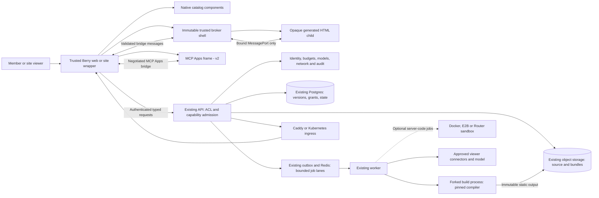

# Scope: artifacts, published sites, mini apps and generative UI

Status: **SCOPE UPDATED — full single-host internal workflow confirmed; technical design proposed**. Written and revised 2026-10-29, then corrected the same day after a code review (file transfers, builds, event-stream routing, permission storage and the agent's save path). This document changes no existing plan or application code. Evidence, product matrices, source access dates and browser measurements are in [the research](../research/artifacts-sites-generative-ui.md). External facts repeated here link to their primary sources; all were accessed **2026-10-29**. Configuration below is the proposed release contract, **not functionality available in today's checkout**.

## One-page recommendation

**Deliver the complete internal artifact-and-app workflow on the operator's existing Berry hostname.** The founder clarified on 2026-10-29 that self-hosted customers should need no additional domain, subdomain, DNS record or wildcard certificate. Editable artifacts, live model/connector calls, persistent data, Berry Apps, dynamic inline components, organization sharing, preview deployments and rollback are all part of the self-hosted release. A source editor alone does not satisfy that release. This remains a scoping task; no application code is implemented here.

**Use the existing platform.** React/TanStack Start hosts a resizable artifact panel; reuse Monaco for source and add a separate Lexical document editor. Use a Berry-owned native component catalog backed by json-render, with existing charts/tables. NestJS handles APIs, Postgres/Drizzle holds versions, ACLs and app data, S3-compatible storage holds source/assets/exports, and the existing worker builds bundles in an isolated, bounded build process and runs bounded jobs. No new application-hosting service. Building, previewing and publishing HTML/React apps needs no sandbox provider; sandboxes remain for optional server-code jobs. With bundled MinIO, file transfers go through the API, so no storage hostname is needed. Existing web/API/worker replicas can scale independently behind the same hostname. Files F1–F8/F12–F16 below.

**Single-host publishing is a first-class feature.** An artifact editor at `/artifacts/<id>`, an org app at `/apps/<id>`, a published internal release at `/sites/<id>` and an immutable preview at `/sites/<id>/previews/<deployment>` all use the existing Berry origin and SSO. The published route serves trusted Berry wrapper code; generated HTML/React runs only in an opaque sandboxed child. Source versions, production aliases and application data stay separate. Files F3–F5/F7–F9.

**The runtime is governed on every call.** `window.berry` requests model calls, approved connectors, personal/shared storage, uploads/downloads and edits through the trusted host. The API applies the viewer's identity, permissions, model allowlist and budget; an artifact receives no connector secrets or normal API session token. Publishing to the organization requires review/ACL checks, and anonymous/public publishing remains disabled. Native and generated apps both use this service layer. Files F1/F3/F6/F8/F11/F12.

**Preserve the real security boundary.** Opaque frames protect app DOM/storage; they are not a complete browser network firewall. The measured WebRTC escape from fetch CSP applies with or without an extra domain. Reviewed generated HTML/React is available on the same host after admin enablement. Strict-egress installations can use the full governed native/catalog app workflow, or add managed-client controls for arbitrary JavaScript. This restriction must be described honestly; DNS must not be presented as the fix. Files F4/F8/F11.

**Delivery sequence, one release objective:** v0 supplies the editor/version/catalog foundation (4–6 engineer-weeks); v1 completes the single-host runtime, Apps, state, sharing and internal deployments (12–18 additional engineer-weeks), plus 3–5 engineer-weeks for the explicit multi-replica/capacity hardening below. These estimates include the unstarted Apps foundations; capacity acceptance is part of the complete release, not an optional promise. v0 is an implementation milestone, not the final self-hosted scope. MCP Apps/compatibility, native WebView parity and richer editing follow in v2. These are estimates, not commitments.

**Cloud is later.** `berry.me` is the future hosted control surface; proposed `berry.host` private renderer and `berry.site` publishing roles are reserved for that deployment. Extra-host tiers, public publishing, PSL work and custom-domain automation below are retained as future design/reference material. None is a dependency of the current single-host release. Separate-domain roles remain proposals until the Cloud launch decision.

## Concrete technology stack and single-host product contract

| Layer | Choice and repository integration |
|---|---|
| Web shell and side panel | Existing React 19 / TanStack Start and Router in `apps/web/package.json`; existing `react-resizable-panels` wrapper in `packages/desktop-ui/src/components/ui/resizable.tsx`; integrate `apps/web/src/components/tasks/web-task-view.tsx` with the new F4 artifact panel. |
| Editing | Reuse `apps/web/src/components/code-editor.tsx` (Monaco, already loading bundled editor/workers locally) for code, HTML/React, JSON, Markdown source and diffs. Add `apps/web/src/components/artifacts/artifact-document-editor.tsx` using the existing Lexical family for a constrained rich document view. The prompt editor remains separate. |
| Inline interaction | Berry's typed JSON catalog, a pinned json-render adapter, existing Recharts and TanStack Table components; form/actions use approved native components. No model-written JavaScript enters the native component tree. Files F1/F5. |
| Generated app preview | Locally bundled React/ReactDOM and esbuild-wasm compilation; immutable trusted broker plus `sandbox="allow-scripts"` opaque child, without `allow-same-origin`. `window.berry` uses a bound MessagePort; all capabilities are host-mediated. Files F4/F12. |
| Backend, persistence and jobs | Existing NestJS API; Postgres/Drizzle immutable version and application-state tables; existing S3/MinIO assets; existing worker/BullMQ execution, with bundle builds in a worker-forked build process and the Docker/Router/E2B provider contract kept for optional server-code jobs; an API file-transfer mode for installs without a browser-reachable storage host. Keep saved org policy authoritative. Files F2/F3/F6/F8/F12, `apps/api/package.json`, `apps/worker/package.json`, `packages/db/package.json`. |

Repository dependency/version observations were read on 2026-10-29. The new package/configuration choices above are proposals. Lexical supports Markdown import/export with explicit transformers; use a fixed supported subset and a single canonical Markdown source for text documents. Do not silently normalize unsupported syntax: preserve it in source mode, and require explicit conversion before rich editing. Save source and schema version together; derive editor state from that version. [Lexical Markdown documentation](https://lexical.dev/docs/packages/lexical-markdown), accessed 2026-10-29. Add the required `@lexical/markdown`/rich-text packages at the existing Lexical version in `apps/web/package.json`; source maps/range hashes bind agent edits to the correct version. Monaco's local package setup is also documented by its [React integration](https://github.com/suren-atoyan/monaco-react#use-monaco-editor-as-an-npm-package), accessed 2026-10-29; retain Berry's existing local loader configuration.

Example routes under **one existing** address, `https://app.example.com`:

```text
/artifacts/<artifact-id>                              editor and version history
/apps/<app-id>                                        reviewed org app and runs
/sites/<site-id>                                      selected production release
/sites/<site-id>/previews/<deployment-id>              immutable private preview
/v1/canvases/*, /v1/sites/*, /v1/canvas-runtime/*       authorized management/runtime APIs
/__berry/render/broker-v1                             empty trusted rendering shell
```

These route paths are distinct UI/API entry points, not origin boundaries. The iframe sandbox supplies the generated-content boundary. The same app session authenticates trusted wrappers; only wrappers call APIs with that session. Never serve generated HTML directly as an executable top-level response under `/sites` or `/artifacts`. Add proposed TanStack route files `apps/web/src/routes/artifacts.$artifactId.tsx`, `apps.$appId.tsx`, `sites.$siteId.tsx`, and `sites.$siteId.previews.$deploymentId.tsx`, using the shared policy/domain services in F3/F8.

**End-to-end release acceptance:** an org member creates and edits a React dashboard beside chat, asks the agent for a targeted update, inspects/restores versions, connects their approved data source, calls an allowed model within budget, and saves personal or explicitly shared app data. They promote a version to Berry Apps, publish a private preview, and release it to selected org members, departments or roles. A second member signs in at the same Berry address, receives their own identity/connection/budget context, and sees only permitted shared data. Updating the draft does not change the released app; promotion/rollback changes code without reverting production data. Removing a member, revoking a connector or disabling the app takes effect on the next read/call and invalidates active grants. Complete this flow on single-VM deployments (bundled MinIO in API transfer mode, and native S3) and Helm deployments, using only the existing app hostname(s), with no storage hostname, no sandbox provider and a cold-cache offline asset check. Files F1–F9/F11/F12.

**Architecture review outcome:** the existing stack is suitable; correctness and capacity depend on the concrete protocols below. This is ready for implementation planning, not a production-scale certification. Target 10,000 organization members and 3,000 concurrent connected users under a specified mixed workload, with overload handled explicitly. A small evaluation VM is not promised that capacity. Files F13–F16; [review evidence](../research/artifacts-sites-generative-ui.md#backend-and-scale-review-of-berry).

## Naming and compatibility

| Name | Meaning and compatibility decision |
|---|---|
| **File** | Existing `StoredFile`: upload, generated binary, source or export. Keep `file_origin`, `artifact_operations`, `/v1/files` and legacy `/v1/artifacts` behavior. No destructive rename/backfill. |
| **Artifact** | User-facing editable output with source, immutable versions, exports and a side-panel editor. Internal type `CanvasArtifact`, new `/v1/canvases` API and `canvas_*` tables avoid collision with stored-file artifacts. “Canvas” is an implementation noun, not a second marketed product. |
| **Version** | Immutable source/assets/capability snapshot. A mutable draft head points to one version. Restoring creates a new head/version. |
| **Site / deployment** | A distribution of a selected artifact/app version. Deployment is immutable; production is a movable alias. Deployments do not own or implicitly roll back application data. |
| **Berry App** | Existing planned skill package plus manifest, typed inputs, policy, UI and run contract. A mini app is a Berry App with a UI entry; a tool is a reviewed headless entry from the same version. |
| **Inline component** | A typed transcript part. Native catalog specs, sandboxed generated visuals and MCP Apps are three distinct rendering tiers. A component can be promoted to an Artifact explicitly. |
| **Browser renderer / execution sandbox** | Different boundaries. Browser renderer hosts untrusted presentation. Docker/E2B/Router executes optional bounded server-code jobs (bundle builds run in the worker's forked build process); it does not automatically contain the viewer's browser network. |

Keep Library as the destination, adding **Files** and **Artifacts** views. Internally rename `ArtifactLibrary` to `FileLibrary` only through a later compatibility export, not by reinterpreting existing records. Add explicit “Open artifact” message parts rather than guessing from an HTML file extension. Files: `apps/web/src/components/library/artifact-library.tsx`, `apps/web/src/lib/cloud-shell-state.ts`, `packages/shared/src/index.ts`, `apps/api/src/main.ts`, `packages/db/src/index.ts`.

### Initial artifact formats

| Format | Proposed first support |
|---|---|
| Documents | v0 Markdown/text source, a constrained Lexical document editor, rendered preview, selection edits and export; existing binary file previews remain available. Rich DOCX round-trip editing is outside this scope. |
| Code | v0 multi-file source/version/diff view with Shiki; code is displayed until a permitted preview/build is requested. |
| SVG and diagrams | v0 bounded SVG image preview plus source editing; raw SVG never enters the trusted app DOM. v1 adds locally compiled Mermaid and validated image output. |
| HTML and React | v0 source/passive preview; v1 approved active preview and immutable bundled deployment. No arbitrary npm install in the viewer. |
| Slides | v1 static HTML slide-deck artifact using the same renderer; existing PPTX/PDF output remains a File. A native collaborative slide editor is out. |
| Dashboards | v0 catalog charts/tables/filters; v1 governed live data and HTML/React dashboards when active policy allows. |

These are Berry scope choices. Storage/export formats do not automatically imply an executable runtime or a native editor. Integration uses F1–F6/F12 below.

## File ownership map

Every design recommendation below maps to these concrete existing or proposed files. `(new)` identifies a future file; none is created by this scoping task. Package-wide work must be narrowed to these entry points in follow-up plans.

| Group | Files and responsibility |
|---|---|
| F1 — contracts/client | `packages/shared/src/canvas-artifacts.ts` (new), `packages/shared/src/generative-ui.ts` (new), `packages/shared/src/index.ts`, `packages/api-client/src/index.ts`: schemas, actions, capabilities, API types and text fallbacks. |
| F2 — persistence and file transfer | `packages/db/src/index.ts`; `apps/api/src/files/file-platform.controller.ts`, `apps/api/src/files/file-platform.service.ts`, `apps/api/src/files/file-lifecycle.ts`, `packages/api-client/src/index.ts`: additive tables/RLS, file references, retention, deletion and the API file-transfer mode. |
| F3 — domain API | `apps/api/src/canvases/canvas.controller.ts`, `canvas.service.ts`, `canvas.module.ts` (new); `apps/api/src/sites/site.controller.ts`, `site.service.ts` (new); `apps/api/src/main.ts`: revisions, grants, sharing, deploys and host routing. |
| F4 — browser boundary | `apps/api/src/rendering/render-gateway.ts` (new); `apps/web/src/components/artifacts/artifact-frame.tsx`, `artifact-broker.ts`, `artifact-panel.tsx` (new); `apps/web/src/lib/site-csp.ts`, `config.functions.ts`, `env.server.ts`, `config.ts`; `apps/web/src/components/code-editor.tsx`, proposed `apps/web/src/components/artifacts/artifact-document-editor.tsx` and the artifact/app/site TanStack routes named above: editors, trusted wrapper, isolated child, CSP and redacted public config. |
| F5 — transcript/catalog | `packages/desktop-ui/src/components/generative-ui/registry.tsx` (new), `berry-thread-view.tsx`, `thread-message-utils.tsx`, `thread-stream.ts`, `berry-markdown.tsx`; `apps/web/src/components/tasks/web-task-view.tsx`, `apps/web/src/lib/session-stream-store.ts`, `apps/web/src/styles.css`: UI parts, selection, replay and theme. |
| F6 — agent integration | `packages/harness/src/harness/system-prompt.ts`; `apps/worker/src/canvas-tools.ts` (new; saves only through the F13 commit module), `apps/worker/src/turn-runner.ts`, `apps/worker/src/mcp-tools.ts`; `apps/api/src/runtime/durable-turn.service.ts`: tool admission, edits, actions and durable execution. |
| F7 — Apps extensions | Proposed `apps/api/src/apps/app-manifest.ts`, `apps.service.ts`, `apps.controller.ts`; `apps/web/src/components/apps/app-detail.tsx`, `app-run.tsx` (new under Plans 002/003); `packages/shared/src/berry-apps.ts` (new): schema-version 2 UI/headless entries. Reconcile filenames with the refreshed plans before coding. |
| F8 — governance | `apps/api/src/runtime/execution-network-policy.ts`, `apps/api/src/model-governance/model-governance.service.ts`, `apps/api/src/identity/identity.repository.ts`, `apps/api/src/audit/audit.service.ts`, `apps/api/src/auth/auth-runtime.ts`, `packages/sandbox-contract/src/provider.ts`: policy ceilings, budgets, auth and audits. |
| F9 — deployment | `deploy/compose.yaml`, `deploy/Caddyfile`, `deploy/Caddyfile.storage`, proposed `deploy/Caddyfile.content-shared`, `deploy/Caddyfile.content-wildcard`, `deploy/Caddyfile.content-custom`; `deploy/.env.example`, `deploy/.env.production.example`, `deploy/README.md`; `deploy/helm/berry-platform/values.yaml`, `deploy/helm/berry-platform/templates/ingress.yaml`, `configmap.yaml`, `services.yaml`, `api-deployment.yaml`, `web-deployment.yaml`, `worker-deployment.yaml`. Never edit or replace `deploy/.env.production` through automation. |
| F10 — native surfaces | `apps/mobile/package.json`, `apps/mobile/src/features/thread/thread-parts.tsx`, `thread-view.tsx`, `apps/mobile/src/theme/theme.tsx`; `apps/mobile/src/features/artifacts/artifact-screen.tsx` and `artifact-webview.tsx` (new, latter v2); `packages/design-tokens/src/index.ts`, `packages/design-tokens/src/css-tokens.ts`: native catalog and later WebView. |
| F11 — administration | `apps/web/src/components/management/admin-content-screen.tsx` (new), `management-navigation.ts`, `admin-policy-screen.tsx`; `apps/api/src/rendering/isolation-check.service.ts` (new); `apps/web/src/components/onboarding/deployment-onboarding.tsx` and proposed `content-isolation-check.tsx` in that directory. Extend the proposal in `advisor-plans/004-production-onboarding-wizard.md`. |
| F12 — packaged assets/build | `packages/artifact-runtime/package.json`, `src/bridge.ts`, `src/compiler.worker.ts`, `src/asset-manifest.ts` (new); `apps/web/package.json`, `apps/web/vite.config.ts`, `apps/worker/package.json`, `Dockerfile`, `pnpm-lock.yaml`; `apps/worker/src/artifact-build.ts` (new): local runtime/compiler dependencies, one pinned compiler shared by the browser draft and the worker's forked build process, deterministic bundles and manifests. |
| F13 — transactional persistence | `packages/canvas-core/package.json`, `src/commit.ts` (new): the one commit protocol, written against a minimal transaction interface; `apps/api/src/canvases/canvas.repository.ts`, `canvas-upload.service.ts`, `apps/api/src/sites/site.repository.ts` (new); `apps/api/src/db/cloud-database.service.ts`, `apps/api/src/db/pg-executor.ts`, `apps/worker/src/pg-executor.ts`, `packages/db/src/index.ts`, `apps/api/src/files/file-lifecycle.ts`: commit protocol, staged uploads, immutable blob references, indexes and bounded queries. API and worker each pass their own executor to the shared module. |
| F14 — invocation and capacity | `apps/api/src/canvases/canvas-runtime.service.ts`, `canvas-runtime.controller.ts` (new); `apps/worker/src/artifact-runtime.ts`, `artifact-build.ts` (new); existing `main.ts`, `jobs.ts`, `processor.ts`, `bullmq.ts`, `outbox.ts`, `pg-executor.ts`; `apps/api/src/budget/budget.service.ts`, `apps/api/src/http/personal-capabilities.service.ts`: durable calls, retries, fair admission, shared OAuth state and pool controls. |
| F15 — fan-out and panel lifecycle | `apps/api/src/http/event-stream.service.ts`, proposed `event-notifier.ts`; `packages/client-core/src/session-stream-store.ts`, `thread-stream.ts`; proposed `apps/web/src/lib/artifact-store.ts`, `apps/web/src/components/artifacts/artifact-panel.tsx`: cursor replay, coalesced notifications, lazy loading, recoverable edits and bounded UI memory. |
| F16 — measured readiness | `apps/api/src/runtime/runtime-metrics.ts`, `apps/worker/src/runtime-metrics.ts`; `deploy/helm/berry-platform/templates/hpa.yaml`, API/web/worker deployment templates and proposed `pod-disruption-budget.yaml`; `deploy/helm/berry-platform/values.yaml`, `deploy/compose.yaml`; proposed `scripts/load-artifacts.mjs`, `apps/web/tests/artifact-workflow.spec.ts`, `artifact-performance.spec.ts`, and existing `apps/web/tests/message-history-performance.spec.ts`: resource requests, draining, observability and capacity/failure tests. |

## Architecture



The site wrapper is trusted Berry code, served on the existing app origin for the self-hosted release. It uses the existing SSO/session and per-site ACLs. Generated content never runs in its DOM. Extra-host dispatch described next applies only to future optional deployment modes. API host dispatch admits only registered content hosts and content/auth paths before normal application routing; content hosts must never expose ordinary `/v1` APIs by accidental proxy fallthrough. Native components use the same domain services without an iframe. Files F3–F6/F8/F9.

### Backend design and the meaning of “versioned”

Keep feature modules (`CanvasesModule`, `CanvasRuntimeModule`, `SitesModule`) with stateless NestJS services and constructor-injected repositories. Pass immutable tenant/actor/resource context explicitly; never store the current viewer in a singleton field. Extend the current `CloudDatabaseService.withTenant`/`PgSqlExecutor` pattern, with Drizzle schema/migrations and parameterized SQL repositories. Production startup must reject a repository executor without transaction support. Do not create a separate per-user pool or move source compilation into request handlers. Files F3/F13/F14.

Version identifiers have separate jobs: `/v1` is the API contract major version; `canvasVersionId` identifies immutable user content; `sourceSchemaVersion`, `catalogVersion`, `bridgeProtocolVersion` and `runtimeAssetSet` identify interpretation/runtime compatibility. Return them explicitly. A bridge or catalog upgrade must not silently reinterpret old source. Retain compatible runtime assets until references expire; if a runtime is revoked for security, block execution and offer an explicit rebuild rather than silently changing a published version. Keep backward-compatible additive changes within `/v1`; breaking semantics need a new contract major, a compatibility period and client migration. Use typed error codes/request IDs, documented pagination and generated client types; reject unknown mutating capabilities rather than ignore them. Rolling upgrades must support the previous bridge/job payload schema until old consumers drain. Files F1/F3/F12/F13/F14.

The editor and agent both use one write path: a server-only commit module (`packages/canvas-core`, F13) that the API's canvas service and the worker's agent tools both call with their own tenant executors. The worker writes Postgres directly today (`apps/worker/src/file-blobs.ts`, `apps/worker/src/sql-repositories.ts`) and has no API client, so the shared module, not an HTTP hop, keeps the protocol in one place. Require an exact head precondition and an idempotency key bound to tenant, actor, operation, resource and request-body digest. Reusing a key with different input is a 409. Missing edit precondition is 428; a body `baseVersion` conflict is 409; a failed HTTP `If-Match` is 412. Return the current authorized head and a conflict code, never overwrite automatically. Keep in-flight idempotency records until resolved and completed records for at least seven days. HTTP conditional semantics: [If-Match](https://developer.mozilla.org/en-US/docs/Web/HTTP/Reference/Headers/If-Match), accessed 2026-10-29. Files F1/F3/F13.

**Commit protocol:** authorize the draft and limits; stage changed objects outside a DB transaction; verify bytes/hash and register/pin the verified blob; then enter one short tenant transaction. Lock or conditionally update the artifact head, recheck ACL/policy/precondition, insert the immutable manifest/version and file references, advance the head revision, and append audit/outbox/idempotency results atomically. A losing concurrent write publishes nothing. After commit, notify subscribers through the outbox. An explicit build/preview/deployment request schedules the authoritative build; autosaving does not enqueue a server build for every keystroke or checkpoint. Coalesce superseded draft-preview work. Return Saved only after the durable commit. No DB lock or pooled connection remains held during network I/O. Files F2/F3/F13/F14.

Postgres and S3 are not one transaction: interrupted uploads remain staged with an expiring lease; only committed manifests become visible. A sweeper removes abandoned objects after a grace period and reference recheck. Extend existing GC before enabling the feature so staging pins, versions, builds, deployments and legal holds all protect blobs. Reference creation and deletion claims must share a transactional state check/lock: a blob already claimed for deletion cannot gain a new live reference. Conditional object writes or provider version IDs defend immutable keys; never infer integrity from a multipart ETag. Validate the chosen S3-compatible backend, not just Amazon S3 semantics. [S3 conditional writes](https://docs.aws.amazon.com/AmazonS3/latest/userguide/conditional-writes.html), accessed 2026-10-29. Files F2/F13.

### Storage that does not grow by copying every version

Use a small complete manifest per version mapping normalized relative paths to verified blob IDs/hashes and byte sizes. Reuse unchanged blobs through the existing tenant-scoped `file_blobs` hash/size deduplication. A complete manifest makes opening/restoring independent of a long patch chain; patches are an editing/diff format, not the only recoverable history. Reject traversal, duplicate normalized paths, symlinks/hard links in imported archives and oversized source maps. Immutable version rows hold metadata/pointers, not bundled JS, base64 images or entire live data snapshots. Files F1/F2/F12/F13.

Postgres holds metadata, ACLs, bounded KV values, operation state and audit references; object storage holds source/assets/bundles/exports and large data snapshots. Initial KV is a small application store, not arbitrary SQL or a warehouse: exact keys, prefix/cursor listing, atomic compare-and-set, bounded batch operations and typed counters. Record-level authorization uses tenant + app instance + environment + personal/shared scope + viewer where applicable. Shared-write permission is separate from shared-read. Large tables use an approved connector or existing file/data handle. No unbounded JSON scans exposed through the bridge. Files F1/F2/F3/F13.

Required indexes include `(tenant_id, canvas_id, revision DESC)` for history; `(tenant_id, updated_at DESC, id DESC)` for live artifact listings; a principal-first lookup index on the existing `resource_acls` if query plans need one, added through the concurrent-index path; unique invocation/idempotency keys; and a unique KV key across app/environment/scope/owner/key. Use a non-null owner discriminator for shared scope so SQL NULL uniqueness cannot create duplicate keys. List/history endpoints default to 50 and cap at 100, use keyset cursors and batched ACL checks, and omit source/large JSON. Data-table pagination stays bounded separately. Explain representative query plans with realistic row counts. Files F2/F3/F13.

Application access and RLS are complementary: use tenant-qualified foreign keys and forced tenant RLS with non-bypass runtime roles; viewer ACLs still need domain checks. Online indexes on existing large tables use Berry's dedicated nontransactional migration path; never run a concurrent-index statement inside the ordinary migration transaction. PostgreSQL documents both restrictions and role behavior. [Row security](https://www.postgresql.org/docs/17/ddl-rowsecurity.html), [index creation](https://www.postgresql.org/docs/17/sql-createindex.html), accessed 2026-10-29. Files F2/F13.

Build/deployment/data lifecycles stay distinct. Promotion pins `(canvasVersionId, buildId, runtimeAssetSet, effective capabilities)` and atomically switches an alias using its own revision precondition. A published app declares the stored-data schema versions it can read/write. Rollback is permitted only if the old bundle can read the current production data schema; otherwise offer a compatible build or a separately reviewed data restore. No destructive app-data migration on page load. Retention can prune unreferenced autosave checkpoints, but never published/pinned/legal-held versions. Files F2/F3/F7/F13.

### Generated HTML/React: compile once, execute only in the frame

A build key includes tenant, source-manifest hash, dependency lock/runtime-asset hash, compiler version and build options. A unique DB record deduplicates builds; a worker lease/fencing generation prevents a stale worker publishing output after a retry. Browser compilation provides a fast **draft** preview, while only the authoritative worker build can be promoted. Store verified JS/CSS/assets and diagnostics/source maps as immutable build outputs. There is no npm install, compile, container allocation or source regeneration when another viewer opens a completed release. Files F12–F14.

The authoritative build runs in the worker, not in a sandbox. The worker forks an isolated build process that receives the source manifest over IPC and bundles it with the same pinned esbuild version (native binary or esbuild-wasm) and read-only in-memory module map as the browser draft. Berry's own resolver is the only plugin and rejects anything outside the module map; there are no user-supplied config files, plugins, loaders, HTTP imports or connector/model credentials. Bundling parses and transforms source without executing it, so no container is needed. Bound each build by the source and file-count limits, an output-size cap and a hard timeout that kills the process; V8 heap flags may not cover WebAssembly memory, so measure peak build memory in Plan K. This keeps preview and publishing working where no sandbox is usable: Compose defaults `BERRY_SANDBOX_PROVIDER` to `e2b`, which needs internet access and `E2B_API_KEY`; `deploy/.env.example` uses `fixture`; and the Docker provider (`packages/sandbox-contract/src/docker-provider.ts`) drives the docker CLI, which Compose does not wire. Sandbox builds stay a later option for an arbitrary-package profile, outside this scope. Type checks, build errors and missing packages are visible beside the source. Worker and browser builds share the import allowlist; incompatible or unavailable imports yield an actionable error. A library change creates a new build/runtime identity. The API never executes generated React SSR, loaders, server actions or Node code; it serves a trusted wrapper and bytes. Files F4/F12/F14.

The wrapper authorizes access, obtains the ready manifest, streams bounded assets and transfers them to the broker without injecting source into the trusted DOM. The opaque child gets inlined local JS/CSS and bounded image/font blobs, with no browser-origin storage assumption. Preserve the current sandbox/CSP restrictions. Parent/broker/child ports are generation-bound and disposed on reload; cap message size, outstanding requests and source-map/error output. The last good preview remains while a new checkpoint compiles. Draft preview remounts reset ephemeral component state; durable app data is kept through the bridge, and published deployments do not hot-swap behind a viewer's active form. Files F4/F12/F15.

Protected bundle responses pass authorization before any cache lookup or 304. Start with private/no-store browser responses; a bounded server-side immutable-byte cache may reuse verified content **after** authorization. Only public shipped runtime assets use public immutable caching. Stream data with backpressure/abort rather than buffering 50 MiB per user. `GET /v1/files/:id/content` already streams through the API with range/ETag support, but uploads do not: today the browser sends multipart parts straight to storage through signed URLs (the parts route in `apps/api/src/files/file-platform.controller.ts`, `presignParts` in `file-platform.service.ts`), and `?download=1` navigations redirect to a signed storage URL. With bundled MinIO, that makes `BERRY_FILES_DOMAIN` a required second hostname. Add `BERRY_FILE_TRANSFER_MODE=api`: the browser sends each part to a new API part route that streams it to `UploadPart`, `download=1` streams instead of redirecting, and the web CSP (`apps/web/src/lib/config.functions.ts`) drops the storage origin. Keep parts at or below 32 MiB so they pass the 40 MB request limit in `deploy/Caddyfile`. `direct` keeps today's signed transfers and stays the default; native S3/R2 needs no operator DNS either way. Sandbox inputs keep today's signed-URL path, so a remote sandbox provider must reach the storage endpoint it is given; that is existing chat behavior, outside the artifact workflow. Signed URLs never enter generated source or saved versions. Files F2/F3/F4/F13/F16.

### Durable runtime calls, budgets and horizontal scaling

Use a `canvas_runtime_invocations` record for a model/connector/server-job action: caller, canvas/version/build, environment, capability/policy revision, request digest/idempotency key, budget reservation, deadline, cancellation state, lease epoch, provider request ID and result reference. A UI model call does not append into the creator's private chat or need a fake chat turn. Share governed provider/tool admission primitives with the durable turn path, keeping artifact orchestration in its own service. Actor identity always comes from the wrapper's authenticated session, never a JSON field supplied by the frame. Files F1/F3/F6/F8/F14.

Small KV/identity reads are bounded ordinary API calls. Potentially slow/paid actions return 202 plus an invocation ID and stream/poll status; the bridge SDK can expose this as a cancellable promise/stream. Persist admission and the outbox atomically; use the existing Redis/BullMQ/worker infrastructure with a separate logical artifact-runtime lane and a bounded build lane. Small installs can run those consumers in the same worker process; larger installs scale worker roles from the same image. Reserve capacity for normal chat and give tenants/viewers fair shares. Explicitly update job schemas, routing and failure policy rather than falling through today's background mapping. Files F6/F14/F16.

Queue IDs alone do not make remote effects exactly once. Retry pure builds and reads with bounded backoff; reuse a provider idempotency key where supported. If a model request may have been accepted before a worker lost its connection, mark the invocation `outcome_unknown` and reconcile by provider request ID where possible. Do not silently launch a second paid request. Connector writes stay outside the initial unreviewed bridge. Keep reservation accounting until outcome resolution/approved reconciliation; never mark an ambiguous paid call free simply because a lease expired. [BullMQ retry-safe jobs](https://docs.bullmq.io/patterns/idempotent-jobs), accessed 2026-10-29. Files F8/F14.

Budgets reserve a conservative bound for the allowed model/output before dispatch, reconcile actual usage once and charge each logical invocation once in Berry's ledger. The provider may still have ambiguous billing, which must be shown. Current tenant-wide admission locking is safe but a possible bottleneck: measure lock wait and query cost in a single large organization. If necessary, add atomic per-period used/reserved balance rows for org/user/department, updated together with ledger entries under consistent lock order. Do not bypass the authoritative database check with eventually consistent Redis counters. Files F2/F8/F14.

Model, connector, build and asset operations each have global/org/viewer concurrency, queue depth and deadlines. Reject excess work promptly with 429 and Retry-After; unavailable dependencies return a bounded 503. Queueing is visible, bounded and cancellable, with admission/policy/budget rechecked before execution. Idle apps consume no worker slots. Read-only connector refresh is a named data-source action shared by that view's components, paused offscreen and jittered; no hidden timer per chart. Default paid generation requires an explicit viewer action/consent, rather than every mount or replay. Files F1/F3/F8/F14/F15.

All authoritative grants, capability consent, idempotency, invocation and connector OAuth flow state must survive API restarts and cross-replica requests. Existing process-local personal-connector OAuth state must move to shared expiring storage with atomic consume before this is claimed. Positive caches are bounded and keyed by tenant/viewer/connection/policy revision; never share live private query results merely because two users opened the same artifact. Recheck current policy/membership on each privileged call; invalidation notifications accelerate UI teardown but are not the only authorization control. Files F8/F14/F15.

### Live updates and opening beside chat

New transcript parts carry stable `canvasId` and `versionId`, optional title/thumbnail reference and a text fallback. Opening performs a direct authorized lookup; never search the first 100 output files by name. Message history pins the referenced version, with an explicit “newer version” action; the working editor follows the draft head. Source and bundle bytes are lazy-loaded only for the selected artifact. Files F1/F4/F5/F15.

Keep a separate artifact store keyed by artifact/version with a byte-bounded LRU. Reuse the existing per-session stream coalescing; a chat token must not re-render Monaco, Lexical or the preview. Keep one editor model and one active generated frame mounted across the panel and transcript combined; snapshots stand in for other/offscreen generated content. Opening the side panel preserves chat scroll, composer draft and keyboard focus; explicit user navigation may focus the panel. Auto-opening a newly created artifact must not steal typing focus. Width is remembered, narrow layouts show a focused artifact view with a clear return-to-chat action, and Back/Forward restores the selected artifact/version. Files F4/F5/F15.

Expose real states: loading, editing, saving, saved, conflict, building, ready, runtime error, access revoked and reconnecting. Debounce source autosave around one second and checkpoint at most every five seconds during continuous edits, with immediate explicit save before publish. Confirm the committed revision before displaying Saved. A conflicting agent/user update preserves both candidates and offers diff/merge/fork; never silently replace a dirty buffer. Unsaved recovery belongs to the trusted app, with tenant/user-separated local drafts, bounded size/TTL and clear-on-logout; an operator can disable persistent browser drafts. Do not promise offline server synchronization. Files F1/F4/F13/F15.

Replace per-subscriber 100 ms polling at scale with coalesced post-commit notifications and shared per-resource fan-out. Reuse existing Redis as an invalidation transport, but Postgres event IDs/cursors remain replay authority. Batch/read once per active resource per API instance, fan out to authorized subscribers, and run a bounded periodic catch-up for missed notifications. A tab multiplexes artifact/runtime events instead of opening a stream per component. Bound per-connection output queues; disconnect slow consumers with a resumable cursor, and add jitter on reconnect. Never keep a database connection checked out for the lifetime of SSE. Use compact `canvas_events` containing typed state changes and authorized result references; do not broadcast source or viewer-private connector data. Assign ordered sequences per resource stream in the same transaction as its change, so out-of-order transaction commits cannot skip events. A signed multiplexed cursor identifies stream positions, not permission; authorize every subscription and catch-up. Expired event retention returns an explicit resync response and reloads an authorized snapshot without rerunning effects. Redis Pub/Sub can lose messages, so it cannot be the durable event log. [Redis delivery](https://redis.io/docs/latest/develop/pubsub/), accessed 2026-10-29. Files F6/F14/F15.

Today `deploy/Caddyfile` exempts only `/v1/sessions/*/events` and `/v1/tasks/*/events` from compression and adds the streaming headers there (`@not_event_streams`, `@event_streams`); the API sets neither header itself. Add `/v1/canvas-events` to both matchers, and have the API send `Cache-Control: no-cache, no-transform` and `X-Accel-Buffering: no` on every event stream so Helm/nginx and other proxies don't buffer it either. Files F9/F15.

### Capacity envelope and release gates

These are **proposed acceptance targets**, not measured capacity or universal hardware promises. Define the deployment size and network conditions in the eventual report; retain the same one-host URL contract when services are scaled out. No extra DNS is required.

| Acceptance workload | Target scenario |
|---|---|
| Membership and corpus | One org with 10,000 members; 100,000 artifacts and 1,000,000 immutable versions, realistic user, department and role ACLs and both many-small/hot-shared-app data distributions. |
| Connected users | 3,000 simultaneous authenticated clients with reconnects, including 500 open editors; most clients view/read rather than call a model continuously. |
| Steady mixed load | 100 metadata/history reads/s, 50 source commits/s, 200 bounded KV operations/s, 10 app opens/s with a 1 MiB bundle fixture; 3 model admissions/s with a 30-second stub duration, 10 connector calls/s, and 30 distinct builds/minute. |
| Failure and burst | Two times offered load for five minutes; one hot shared app; same-version save collisions; kill API/worker during commit/paid-call/build; temporary Redis/S3 loss; revoke a viewer mid-session. Expected overload responses are measured separately from successful throughput. |
| Duration | One-hour steady run plus an eight-hour leak/retention soak; repeat the critical flow against real supported providers at an explicitly budgeted lower rate. Stubs prove platform capacity, not provider throughput. |

At three model calls/second lasting 30 seconds, about 90 concurrent model operations are needed before chat/connector headroom; this is sizing arithmetic, not a throughput guarantee. At 10 fresh 1 MiB app opens/second, bundle transfer alone is about 10 MiB/s before overhead. Therefore a user count cannot substitute for concurrency, database I/O, memory, bandwidth or provider quotas. Files F14/F16.

Proposed service targets at that measured workload: p95 small metadata/KV reads under 300 ms, p95 source commits under 750 ms for changes up to 64 KiB, p95 admitted-action acknowledgment under 500 ms, and p95 durable UI event lag under one second. Report queue wait separately from provider execution. Exclude expected authorization/conflict/quota rejections from 5xx counts but publish their rates. No lost acknowledged version, cross-viewer data exposure, duplicate local billing reconciliation or unauthorized published revision is acceptable. Files F13–F16.

For the editor, preserve `docs/message-history-performance.md` and its real 10,000-message benchmark: bounded mounted rows/observers and the eight-task cache. Add a 1,000-component transcript and 20 open/edit/close cycles. Measure warm panel responsiveness and cold 1 MiB app readiness on a declared mid-range device/network; initial targets are 200 ms for visible panel feedback and three seconds for cold interactive readiness at 50 Mbps/50 ms RTT. Native typing should stay responsive while chat streams and builds finish. Capture p95 input latency, long tasks, worker/frame count, heap after collection where available, keyboard/screen-reader behavior and reduced motion. No unbounded growth across cycles. Files F4/F5/F15/F16.

Pool sizing is a deployment contract: sum `(maximum replicas including rollout surge × per-process pool max)` for API, privileged/platform API pools, every worker role, maintenance and other DB consumers; keep at least 25% of database connection capacity for recovery/admin headroom. Add explicit API/platform pool envs, preserve existing worker pool envs and bound connection acquisition/statement/lock waits. Do not solve a slow query by opening thousands of DB connections. PgBouncer can be an optional operator optimization after tenant-context/transaction compatibility checks, never required for basic functionality. [node-postgres pool sizing](https://node-postgres.com/guides/pool-sizing), accessed 2026-10-29. Files F9/F13/F14/F16.

Proposed new controls: `BERRY_API_DB_POOL_MAX`, `BERRY_PLATFORM_DB_POOL_MAX`, `BERRY_DB_ACQUIRE_TIMEOUT_MS`, `BERRY_ARTIFACT_RUNTIME_CONCURRENCY`, `BERRY_ARTIFACT_BUILD_CONCURRENCY`, `BERRY_ARTIFACT_QUEUE_LIMIT`, `BERRY_ARTIFACT_QUEUE_GLOBAL_LIMIT`, `BERRY_ARTIFACT_EVENT_FANOUT_ENABLED`. Wire explicit bounded values into Compose/Helm and admission logic; map runtime concurrency to worker consumers and build concurrency to concurrent build processes, whose memory counts against the worker container's limit. Exact production values follow the measured deployment profile, not the user count alone. Preserve `BERRY_WORKER_DB_POOL_MAX` and its foreground/background overrides. Files F9/F14/F16.

Helm must expose CPU/memory requests/limits, startup/readiness checks, graceful SSE/job draining, disruption budgets and independent web/API/worker-role replicas. Existing CPU-utilization HPAs lack resource requests in the inspected templates; add them. Add queue-oldest-age/in-flight metrics where the operator has a metrics adapter, or document bounded manual scaling without requiring a new metrics service. Scale-in must stop admissions, finish or checkpoint bounded work, and let durable leases recover. Do not promise HA from a single VM; replicated Postgres/Redis/object storage and their recovery policy remain operator responsibilities. [Kubernetes HPA](https://kubernetes.io/docs/concepts/workloads/autoscaling/horizontal-pod-autoscale/), accessed 2026-10-29. Files F9/F14/F16.

Instrument stage latency, pool/lock wait, queue age, build cache hit/miss, stream lag/backpressure, object bytes, KV contention, budgets and revocation failures. Logs/traces use opaque IDs, never source/connector payloads; metrics avoid per-user/artifact label cardinality. Alert on orphan buildup, stuck invocations, failed reconciliation and retention backlog. The capacity report must record image/runtime hashes, topology/resources, DB size/index plans, workload and cache state, provider mode, results and bottlenecks. Until that report passes, describe the design as **intended for thousands of users**, not validated for them. Files F13–F16.

### Three independent security profiles

1. **Disabled active code (default):** native catalog; bounded passive previews; HTML with scripts disabled; SVG as a bounded image/raster preview. No model JavaScript reaches a browser. Use for first install and strict networks.
2. **Reviewed active code:** operator allows generated JavaScript with CSP, opaque origins, explicit capability grants and content review. This protects credentials and authority but is **not an enforceable browser egress allowlist**. Do not release private connector/file data to active content when organization policy requires hard browser egress enforcement. Public approved snapshots and native UI remain useful.
3. **Managed active code:** same application controls plus externally enforced managed-browser/network policy. The operator must prove controls, including WebRTC, navigation, DNS and private-network destinations, on supported clients. A server flag or monkey-patching `fetch`/`RTCPeerConnection` is not proof. Failing clients fall back to native/passive content.

These profiles apply to all DNS tiers, including Cloud. An extra domain cannot make arbitrary JavaScript safe under every network policy. For organizations requiring both unrestricted authored JS and a hard resource/egress boundary on unmanaged clients, defer a sandbox browser that streams pixels; it costs server resources and is outside v1. Files F4/F8/F11/F12. Evidence: [research experiment](../research/artifacts-sites-generative-ui.md#browser-isolation-experiment), [CSP3](https://www.w3.org/TR/CSP3/) (accessed 2026-10-29).

## Deployment tiers and exact proposed configuration

**Current implementation target: tier A with the full internal product.** Tiers B/C, additional certificates, PSL registration and public/custom-domain hosting are future reference designs retained from the research. No tier-B/C work is needed to complete the current release. Files F3/F9/F11.

### Configuration contract

The following new variables are **proposals** consumed by API/web/worker where relevant. Keep private keys and DNS-provider tokens server-side. Public web config receives only booleans and validated origins. Existing `BERRY_DOMAIN`, auth URLs and `BERRY_ARTIFACT_S3_*` keep their meanings.

| Variable | Default / accepted value | Consumer |
|---|---|---|
| `BERRY_CANVASES_ENABLED` | `true` after v0 migration | API/web/worker |
| `BERRY_GENERATIVE_UI_ENABLED` | `true` for native catalog | API/web/worker |
| `BERRY_RENDER_MODE` | `opaque` for the current release; `shared`/`wildcard` reserved for the future hosting track | API/web; proxy fragment selected separately |
| `BERRY_ACTIVE_CONTENT_POLICY` | `disabled`; also `reviewed`, `managed` | API policy ceiling/web capability check |
| `BERRY_RENDER_SHARED_HOST` | empty; hostname only in shared mode | API/Caddy |
| `BERRY_RENDER_BASE_DOMAIN` | empty; hostname suffix in wildcard mode | API/Caddy |
| `BERRY_SITES_ENABLED` | `true` once v1 is installed; only authorized internal deployments in single-host mode | API/web |
| `BERRY_SITES_PUBLIC_ENABLED` | `false`; hard deployment ceiling above org setting | API/web |
| `BERRY_SITES_BASE_DOMAIN` | empty; wildcard suffix for tier C publishing | API/Caddy |
| `BERRY_SITES_CUSTOM_DOMAINS_ENABLED` | `false`; future Cloud/public track only | API/Caddy |
| `BERRY_CONTENT_PROXY_IMPORT` | `/etc/caddy/content/disabled/*.caddy` | Caddy; only selected fragment mounted there |
| `BERRY_CONTENT_TLS_MODE` | `automatic`; also `provided`, `internal` | Deployment renderer selects explicit TLS stanza |
| `BERRY_CONTENT_TLS_CERT_FILE`, `BERRY_CONTENT_TLS_KEY_FILE` | empty; container paths for provided certificates | Caddy only |
| `BERRY_ARTIFACT_ASSET_SET` | shipped manifest ID, e.g. `berry-runtime-v1` | API/web/worker; same manifest/hash on all |
| `BERRY_FILE_TRANSFER_MODE` | `direct` (default: today's signed browser-to-storage transfers); `api` streams upload parts and `download=1` responses through the API, so bundled MinIO needs no storage hostname | API/web; the web CSP omits the storage origin in `api` mode |
| `BERRY_API_DB_POOL_MAX` / `BERRY_PLATFORM_DB_POOL_MAX` | `10` / `2` per API process; include both in the total connection budget | API executors |
| `BERRY_DB_ACQUIRE_TIMEOUT_MS` | `2000`; return a bounded overload error on exhaustion | API/worker executors |
| `BERRY_ARTIFACT_RUNTIME_CONCURRENCY` / `BERRY_ARTIFACT_BUILD_CONCURRENCY` | `4` / `1` per worker process; evaluation defaults, not the capacity-test configuration | Worker registered consumers |
| `BERRY_ARTIFACT_QUEUE_LIMIT` / `BERRY_ARTIFACT_QUEUE_GLOBAL_LIMIT` | `100` queued artifact jobs per tenant / `1000` across the deployment; transactional admission counts, excluding running work | API/worker admission |
| `BERRY_ARTIFACT_EVENT_FANOUT_ENABLED` | `true` after the shared fan-out migration; disabling it is a small-install rollback mode that invalidates the scale claim | API event delivery |

No capability, budget or hostname is trusted because the browser supplies it. Reject URLs with credentials, ports in public host config, IP literals for wildcard mode, conflicting suffixes, app/storage-host overlap and unknown Host values. Organization settings may narrow environment ceilings, never widen them. Files F1/F3/F4/F8/F9.

**Future B/C deployment wiring only:** the current tier-A release needs none of the extra-host imports, content mounts or TLS variables below. When those optional modes are implemented, add this second top-level import to `deploy/Caddyfile`, alongside the existing storage import; do not replace that import:

```caddyfile
import {$BERRY_CONTENT_PROXY_IMPORT:/etc/caddy/content/disabled/*.caddy}
```

Merge `strict_sni_host on` into the existing global `servers` block in `deploy/Caddyfile`, preserving `protocols h1 h2`. Caddy then rejects TLS SNI/Host mismatches at the edge; the API still checks the registered Host independently. This option exists in the pinned [Caddy 2.10 source](https://github.com/caddyserver/caddy/blob/v2.10.0/caddyconfig/httpcaddyfile/serveroptions.go) (accessed 2026-10-29). A TLS-terminating load balancer must enforce the same boundary itself; do not trust an arbitrary client-supplied SNI header. Files F9.

The future B/C release must ship/mount `deploy/content/disabled/` (empty), `deploy/content/shared/` and `deploy/content/wildcard/` directories, containing only the selected, reviewed fragment. Alternatively mount the named fragment at the exact container path given below. In `deploy/compose.yaml`, pass the following through the existing `caddy.environment` mapping and mount `./content:/etc/caddy/content:ro`; for supplied certificates additionally mount `./content-tls:/etc/caddy/content-tls:ro`. These are new content directories, not the existing object-storage mount. Keep Caddy's persistent `/data` volume.

```yaml
BERRY_CONTENT_PROXY_IMPORT: ${BERRY_CONTENT_PROXY_IMPORT:-/etc/caddy/content/disabled/*.caddy}
BERRY_RENDER_SHARED_HOST: ${BERRY_RENDER_SHARED_HOST:-}
BERRY_RENDER_BASE_DOMAIN: ${BERRY_RENDER_BASE_DOMAIN:-}
BERRY_SITES_BASE_DOMAIN: ${BERRY_SITES_BASE_DOMAIN:-}
BERRY_CONTENT_TLS_CERT_FILE: ${BERRY_CONTENT_TLS_CERT_FILE:-}
BERRY_CONTENT_TLS_KEY_FILE: ${BERRY_CONTENT_TLS_KEY_FILE:-}
```

The deployment templates separately pass the contract's API/web/worker variables to those services. The release selects/generates the appropriate TLS stanza from `BERRY_CONTENT_TLS_MODE`; Caddy does not interpret that variable by itself. Run `docker compose --env-file <operator-env-file> -f deploy/compose.yaml config --quiet`, then Caddy validation and isolated staging smoke checks. This task does not change or read production environment files. Files F9.

### Tier A — existing app host, zero new DNS

Example app `app.example.com`, existing TLS and object storage unchanged:

```dotenv
BERRY_DOMAIN=app.example.com
# Bundled MinIO: stream files through the API and import the existing
# comment-only storage fragment, so no files hostname is served.
# Native S3/R2 may keep BERRY_FILE_TRANSFER_MODE=direct.
BERRY_FILE_TRANSFER_MODE=api
BERRY_STORAGE_PROXY_IMPORT=/etc/caddy/storage/native/*.caddy
BERRY_CANVASES_ENABLED=true
BERRY_GENERATIVE_UI_ENABLED=true
BERRY_RENDER_MODE=opaque
BERRY_ACTIVE_CONTENT_POLICY=reviewed
BERRY_SITES_ENABLED=true
BERRY_SITES_PUBLIC_ENABLED=false
BERRY_RENDER_SHARED_HOST=
BERRY_RENDER_BASE_DOMAIN=
BERRY_SITES_BASE_DOMAIN=
```

This is the **full internal deployment recipe**, after the administrator enables reviewed active content. A new installation may retain `disabled` until that choice is made; no DNS step is required to enable `reviewed`. Bundled-MinIO installs set `BERRY_FILE_TRANSFER_MODE=api` and import the existing comment-only storage fragment, so Caddy neither serves nor requests a certificate for `BERRY_FILES_DOMAIN`. No sandbox provider is needed: the worker builds bundles itself. It supports editable documents/code, generated HTML/React apps, dynamic native components, versioning, governed model/connector calls, personal/shared saved data, the org App catalog, sharing with selected users, departments, roles or the whole org, authenticated preview URLs, publication, rollback and unpublication. Public/external audiences remain unavailable in this mode. Runtime storage is server-backed even though browser localStorage/IndexedDB are unavailable inside the opaque child.

Pass the four enablement/policy variables, `BERRY_RENDER_MODE` and `BERRY_FILE_TRANSFER_MODE` to the existing API/web/worker configurations in `deploy/compose.yaml` and the Helm ConfigMap/deployments; host secrets remain server-only. Keep the current app certificate, existing proxy and existing services. The app's existing `frame-src` must explicitly permit only the same-origin immutable broker route; the broker's separate policy isolates generated code. The `/artifacts`, `/apps` and `/sites` routes use the ordinary web fallback; `/v1/*` already reaches API. Add the broker route and the event-stream matcher change below, plus corresponding Helm web-host path routing. No content-host import/mount or TLS change is necessary. Files F3/F4/F9.

Add **one immutable broker-shell route** at `https://app.example.com/__berry/render/broker-v1`. It serves trusted static shell bytes, no artifact data, IDs, tokens or user-controlled HTML. Proxy that path to API, stripping `Cookie` and `Authorization`; source/data arrive later through a bound channel from the authenticated parent. Keep all existing `/v1/files/*/content`, `/v1/artifacts/*` and storage deny-execution headers. Caddy's ordinary application matcher must exclude the broker if its defaults would conflict with the explicit broker response. No relaxed CSP on the chat page. Files F4/F9.

Inside the existing app-host Caddy block, place this route before the web fallback; keep the existing API and file routes:

```caddyfile
@content_broker path /__berry/render/broker-v1
reverse_proxy @content_broker api:3000 {
    header_up -Cookie
    header_up -Authorization
    header_down -Set-Cookie
}
```

Extend the two existing stream matchers in the same block so the multiplexed artifact stream is neither compressed nor buffered:

```caddyfile
@not_event_streams {
    not path /v1/sessions/*/events /v1/tasks/*/events /v1/canvas-events
}
@event_streams path /v1/sessions/*/events /v1/tasks/*/events /v1/canvas-events
```

The gateway emits the broker headers below. If edge headers would override them, exclude only this exact path from those edge matchers and emit the complete security header set at the gateway. Never turn the general file matcher into an executable-content route. Files F4/F9.

The shell gets HTTP CSP below and `sandbox="allow-scripts"` on its iframe. Its untrusted inner `srcdoc` gets a separate `sandbox="allow-scripts"`, never `allow-same-origin`. The trusted shell isolates child policy from the app's nonce and existing third-party frame allowlist. For passive HTML remove `allow-scripts` from the inner frame. The shell must not interpolate source into its own HTML/script; receive it as structured-clone data and assign only the child's srcdoc. Direct top-level shell access reveals no content.

```http
Content-Security-Policy: default-src 'none'; script-src 'unsafe-inline'; style-src 'unsafe-inline'; img-src data: blob:; font-src data:; media-src data: blob:; connect-src 'none'; frame-src 'none'; worker-src 'none'; base-uri 'none'; form-action 'none'; frame-ancestors https://app.example.com; sandbox allow-scripts; webrtc 'block'
X-Content-Type-Options: nosniff
Referrer-Policy: no-referrer
Cache-Control: no-store
Permissions-Policy: camera=(), microphone=(), geolocation=(), clipboard-read=(), clipboard-write=(), fullscreen=()
```

`unsafe-inline` is confined to this opaque rendering context; no eval is allowed. The draft WebRTC directive is defense in depth, **not relied upon**. `frame-src 'none'` allowed srcdoc but blocked its outbound navigation in the Chromium experiment; cross-browser verification is a release gate. No service worker may have existed on a reused content origin: use fresh origins or explicit cleanup. `X-Frame-Options: SAMEORIGIN` may remain for this same-host shell; CSP is the explicit ancestor control. Host-mediated download/copy/expand works outside the sandbox.

### Tier B — future optional shared content hostname

DNS: add `content.example.com CNAME app.example.com.` (or A/AAAA to the same edge). A separate registrable domain such as `content.example.net` is preferable if available. Internal DNS is sufficient behind VPN. No wildcard needed.

```dotenv
BERRY_RENDER_MODE=shared
BERRY_RENDER_SHARED_HOST=content.example.com
BERRY_ACTIVE_CONTENT_POLICY=disabled
BERRY_SITES_ENABLED=true
BERRY_SITES_PUBLIC_ENABLED=false
BERRY_CONTENT_TLS_MODE=automatic
BERRY_CONTENT_PROXY_IMPORT=/etc/caddy/content/shared/*.caddy
```

Mount the proposed `deploy/Caddyfile.content-shared` at `/etc/caddy/content/shared/content.caddy:ro`. Pass all referenced variables to the `caddy` container; add API/web/worker config independently in `deploy/compose.yaml`—Compose does not forward host env automatically.

```caddyfile
{$BERRY_RENDER_SHARED_HOST} {
    @broker path /__berry/render/*
    handle @broker {
        reverse_proxy api:3000 {
            header_up -Cookie
            header_up -Authorization
            header_down -Set-Cookie
            header_down -X-Frame-Options
        }
    }
    handle {
        reverse_proxy api:3000 {
            header_up -Authorization
        }
    }
}
```

The API's exact-host content gateway handles this host, with only `/__berry/render/*`, `/s/<site-id>`, site auth and scoped site APIs. Unknown paths return 404; no normal API/web fallback. The gateway whitelists only its own scoped site cookie on wrapper/API routes and rejects arbitrary forwarded identity headers. The shared broker uses the same restrictive CSP, with `frame-ancestors` set to the configured app and permitted trusted wrapper origin. Remove X-Frame-Options on this cross-origin route at **both** edge and API; do not add a second conflicting CSP. The app's `frame-src` adds precisely `https://content.example.com`. Files F3/F4/F9.

Offers a separate-host location for the same internal site-wrapper feature already available in tier A, with independent response policy: wrappers at `https://content.example.com/s/<site-id>`. Generated frames stay opaque, so they do not share localStorage/IndexedDB even though the wrappers share a hostname. Brokered state is available. No per-artifact browser storage, service workers, device access or public publishing is unlocked. Avoid presenting the hostname change as stronger egress enforcement.

For a corporate sibling, first verify `__Host-` host-only auth cookies in `apps/api/src/auth/auth-runtime.ts`, audit all state-changing routes for CSRF/Origin checks, and avoid adding content hosts to `BERRY_AUTH_TRUSTED_ORIGINS` or API CORS. Host-only cookies alone do not stop same-site requests carrying app cookies. Broad corporate SSO cookies may arrive at the edge; exclude content routes from generic SSO middleware and redact/drop cookies before application logging. Corporate policy may therefore require the separate registrable-domain option despite these controls.

### Tier C — future Cloud/per-artifact origins and external publishing

Example app remains `app.example.com`; renderer base `render.example.net`; publishing base `sites.example.org`. Both are separate from the app's registrable domain. An operator can use two subtrees on one dedicated user-content domain, but then publishing/rendering share reputation and a site boundary until suitable PSL treatment; do not promise Cloud's reputation separation.

DNS to edge address `192.0.2.10` (documentation address; replace with the operator's edge):

```text
*.render.example.net.  300 IN A 192.0.2.10
*.sites.example.org.   300 IN A 192.0.2.10
```

Add AAAA only when IPv6 actually reaches the edge. Each artifact revision receives one random label, `r-<opaque-id>.render.example.net`; no tenant or title in DNS. Each site has `s-<opaque-id>.sites.example.org`; preview/deploy wrappers use `d-<opaque-id>.sites.example.org`. Their executable child uses `p-<opaque-id>.sites.example.org`, mapped to the deployment and preview/production environment. All published-site execution, including custom domains later, stays under this sites namespace; it never loads executable code from the private renderer domain. A single-label wildcard certificate covers these; `tenant.artifact.render.example.net` would require a different certificate/routing design.

```dotenv
BERRY_RENDER_MODE=wildcard
BERRY_RENDER_BASE_DOMAIN=render.example.net
BERRY_SITES_BASE_DOMAIN=sites.example.org
BERRY_SITES_ENABLED=true
BERRY_SITES_PUBLIC_ENABLED=false
BERRY_ACTIVE_CONTENT_POLICY=disabled
BERRY_CONTENT_TLS_MODE=provided
BERRY_CONTENT_TLS_CERT_FILE=/etc/caddy/content-tls/fullchain.pem
BERRY_CONTENT_TLS_KEY_FILE=/etc/caddy/content-tls/privkey.pem
BERRY_CONTENT_PROXY_IMPORT=/etc/caddy/content/wildcard/*.caddy
```

Cheapest stock-Caddy path: operator supplies one PEM certificate covering both wildcard names (or separate certificate/key pairs in separate blocks). Mount its directory read-only at `/etc/caddy/content-tls`; operator owns renewal and a validated Caddy restart. The current `deploy/Caddyfile` sets `admin off`, so `caddy reload` is unavailable; atomically replace the mounted cert/key, validate, then restart only `caddy`, allowing a brief edge interruption. A later reviewed loopback/Unix-socket admin configuration can support graceful reload without a public admin port. [Caddy admin behavior](https://caddyserver.com/docs/caddyfile/options#admin), accessed 2026-10-29. Mount the wildcard fragment only. This example uses the same combined-SAN certificate in both blocks:

```caddyfile
*.{$BERRY_RENDER_BASE_DOMAIN} {
    tls {$BERRY_CONTENT_TLS_CERT_FILE} {$BERRY_CONTENT_TLS_KEY_FILE}
    reverse_proxy api:3000 {
        header_up -Cookie
        header_up -Authorization
        header_down -Set-Cookie
        header_down -X-Frame-Options
    }
}
*.{$BERRY_SITES_BASE_DOMAIN} {
    tls {$BERRY_CONTENT_TLS_CERT_FILE} {$BERRY_CONTENT_TLS_KEY_FILE}
    @site_broker path /__berry/render/*
    handle @site_broker {
        reverse_proxy api:3000 {
            header_up -Cookie
            header_up -Authorization
            header_down -Set-Cookie
            header_down -X-Frame-Options
        }
    }
    handle {
        reverse_proxy api:3000 {
            header_up -Authorization
        }
    }
}
```

The API keeps the original Host, validates it against an exact revision/deployment registry and serves only content gateway routes. Unknown wildcard names return 421/404. The renderer remains an empty broker shell until the trusted parent sends an authorized bundle. Published site wrappers authenticate/authorize before retrieving protected versions; public wrappers receive only approved public bundles. Add `https://*.render.example.net` to the **app's** frame-src; do not allow those origins to call ordinary APIs with CORS. Site-wrapper CSP permits only its own scoped APIs and its exact `p-…` deployment frame. The gateway binds wrapper and broker roles to registered hosts, accepts only the declared ancestor on that broker, and never serves a wrapper/auth cookie on a broker-only host. Public sites cannot request a private `r-…` render origin. Generated source remains separate from the wrapper DOM. Files F3/F4/F9.

**What C adds:** distinct browser origins and an eligible external publishing namespace. Immutable previews, production aliases and rollback already work on same-host paths in tier A. The current single-host release uses the portable opaque profile. The future hosting track may allow same-origin within a dedicated artifact origin for reviewed MCP Apps/browser APIs, with storage treated as cache and service workers still forbidden. Separate origins permit this option; they do not require it. Public publishing requires a completed abuse/quota/data-release gate and `BERRY_SITES_PUBLIC_ENABLED=true` plus organization enablement.

### TLS alternatives, Kubernetes and custom domains

| Environment | Exact operating choice |
|---|---|
| Public single hostname, stock Caddy | `automatic`: omit explicit `tls`; point DNS at edge and permit ACME HTTP-01 port 80 or TLS-ALPN port 443. A private VPN-only host cannot use those public challenges without a reachable validation path. |
| Wildcard managed by Caddy | Build a pinned Caddy 2.10 image with the operator's DNS provider module using the official `caddy:2.10-builder`/`xcaddy build --with github.com/caddy-dns/<provider>` pattern. Replace the supplied-cert stanza with `tls { dns <provider> ... }`; inject a zone-scoped token as a secret. Credentials alone cannot enable a missing module. |
| DNS-01 delegation | Delegate `_acme-challenge` through CNAME to a controlled challenge zone when supported by the selected solver; grant only that zone. Check the exact provider configuration rather than assuming the registrar supports an API. |
| Corporate PKI / air-gap | `provided`: mount corporate-issued PEM chain/key; or `internal`: use `tls internal` in each selected content block and distribute Caddy's root through device management. Internal issuance without client trust installation is not a working browser deployment. Back up CA key material separately. |
| Kubernetes | Add `content.mode`, `content.activePolicy`, `content.sharedHost`, `content.renderBaseDomain`, `content.sitesBaseDomain`, `content.tlsSecretName`, `content.sitesEnabled`, `content.publicEnabled` to chart values. ConfigMap emits matching env values; API/web/worker templates consume them. Reuse the API Service on port 80. Create separate content Ingress rules/TLS, with no inherited SSO/CSP annotation. |
| Custom domains, v2 | Exact per-domain DNS proof and host registry before routing/certificate issuance. Use on-demand TLS on Compose with an internal fail-closed permission endpoint; Kubernetes creates per-domain Ingress/Certificate records through a restricted controller or operator action. Existing wildcard certs do not cover arbitrary customer domains. |

Sources: [Caddy HTTPS](https://caddyserver.com/docs/automatic-https), [Caddy DNS/custom modules](https://caddyserver.com/docs/caddyfile/options#acme-dns), [official Docker build pattern](https://github.com/docker-library/docs/blob/master/caddy/README.md#adding-custom-caddy-modules), [cert-manager DNS-01](https://cert-manager.io/docs/configuration/acme/dns01/), [Kubernetes Ingress](https://kubernetes.io/docs/concepts/services-networking/ingress/) — all accessed 2026-10-29. The placeholders above are provider-specific intentionally; no production DNS provider is assumed.

Concrete Helm values for tier C:

```yaml
content:
  mode: wildcard
  activePolicy: disabled
  renderBaseDomain: render.example.net
  sitesBaseDomain: sites.example.org
  tlsSecretName: berry-content-tls
  sitesEnabled: true
  publicEnabled: false
```

The proposed content Ingress has rules for `"*.render.example.net"` and `"*.sites.example.org"`, each routing `/` to `berry-platform-api:80` (the current service name from `_helpers.tpl`; templates use `{{ include "berry-platform.name" . }}-api`), and TLS hosts with those same names using `berry-content-tls`. With a supplied certificate:

```sh
kubectl -n berry create secret tls berry-content-tls \
  --cert=/operator/certs/fullchain.pem --key=/operator/certs/privkey.pem
```

Or issue this through an operator-configured DNS-01 ClusterIssuer:

```yaml
apiVersion: cert-manager.io/v1
kind: Certificate
metadata:
  name: berry-content
  namespace: berry
spec:
  secretName: berry-content-tls
  dnsNames: ["*.render.example.net", "*.sites.example.org"]
  issuerRef:
    name: berry-dns01
    kind: ClusterIssuer
```

`berry-dns01` must already contain the correct provider/secret/zone configuration. Tier B substitutes one precise host/cert and `mode: shared`. Tier A adds only `/__berry/render/` path routing to API under the existing web host. If Helm uses different web/API hosts, retain that supported arrangement; place the empty broker on webHost via path routing. To consolidate to one host, change Ingress to `/v1`, `/healthz`, `/readyz`, `/__berry/render` → API and `/` → web; do not create two `/` rules with the same hostname. Files F9.

For Compose custom domains, the proposed v2 global Caddy option is:

```caddyfile
{
    on_demand_tls {
        ask http://api:3000/internal/content/tls-allow
    }
}
https:// {
    tls {
        on_demand
    }
    reverse_proxy api:3000
}
```

Merge the global block into the existing one; do not duplicate it. The callback returns 2xx only for an exact verified, active domain belonging to an eligible tenant, with issuance quotas; otherwise non-2xx. Bind this endpoint to internal service access and deny it on public app/content hosts. The catch-all gateway must reject all unregistered Hosts; the previously specified edge `strict_sni_host on` rejects SNI/Host mismatches; it cannot expose regular API routes. This stanza is a future contract requiring `caddy validate` against pinned 2.10 before release, not a validated deployment from this task. Caddy's newer JSON API uses permission modules; use the interface supported by the pinned version. [On-demand TLS](https://caddyserver.com/docs/automatic-https#on-demand-tls), accessed 2026-10-29.

For a custom subdomain, publish its CNAME to the operator's stable sites edge name and `_berry-site.<custom-host>` TXT containing a server-generated verification token. For an apex use A/AAAA/ALIAS supported by that DNS provider. Require registration in Berry before traffic/cert issuance. For Kubernetes, the selected TLS-terminating ingress controller must have a tested equivalent of SNI/Host validation; if it does not, custom domains remain disabled rather than relying on an unauthenticated forwarded header. Revalidate periodically and on ownership changes; quarantine removed names, revoke grants and disable the old mapping. Use ACME staging for setup, persistent certificate storage, issuance backoff and limits. Current Let's Encrypt limits include 50 new certificates/registered domain/7 days and 300 orders/account/3 hours; consult live limits before high-volume rollout. [Rate limits](https://letsencrypt.org/docs/rate-limits/), accessed 2026-10-29.

### Recommended operator defaults

| Operator | Recommendation |
|---|---|
| Single-VM evaluation | Tier A with the complete internal workflow; enable reviewed active content during admin setup when desired. Native/catalog apps also work with active disabled. Existing HTTPS, no new service or DNS; bundled MinIO uses `BERRY_FILE_TRANSFER_MODE=api`, and builds need no sandbox provider. |
| Enterprise behind SSO/VPN | Tier A for the complete release; same-origin trusted wrappers reuse SSO, with per-app ACLs and governed calls. Reviewed/managed active profile is explicit; no public publishing and no extra DNS requirement. |
| Air-gapped installation | A/B, active disabled unless managed-client controls are proven; corporate CA; worker-forked builds with the shipped compiler, API file transfers, local models/connectors; all package/font assets preloaded. No E2B/public CDN/map-tile dependency. |
| Kubernetes | Tier A with existing web/API ingress and certificate; add the broker path under webHost. App distribution, preview and rollback use normal web paths. Future C is optional, not a scale/feature prerequisite. |
| Berry Cloud | C: `*.berry.host` renderer, `*.berry.site` publishing, trusted `berry.me`. DNS-01 and distinct certificates/abuse controls. Same API/runtime contract and default public-off organization setting as self-host. |

### Domain proposal and PSL

For **future Berry Cloud only**, propose `berry.host` solely for private/in-app execution origins, and `berry.site` for externally visible sites. The current self-hosted release neither requires nor configures these domains. Reserve apex hosts for service notices/abuse routing, never shared auth. Separate registrable domains reduce the chance that a public phishing report blocks every private artifact; they do not guarantee reputation isolation.

Neither name appeared in the [official PSL](https://publicsuffix.org/list/public_suffix_list.dat) snapshot accessed 2026-10-29. Propose PRIVATE entries for both when they serve eligible mutually untrusting users. Owner-controlled PR, tests, `_psl.<domain>` TXT pointing to the PR, registration longevity and an operational contact are required; approval and browser propagation are not guaranteed. Do not request entries for each private enterprise deployment, and do not use PSL as a certificate-rate-limit workaround. Before propagation, sibling content hosts remain same-site: use host-only cookies, CSRF and deny broad cookies regardless. [PSL guidelines](https://github.com/publicsuffix/list/wiki/Guidelines), accessed 2026-10-29. Founder approval required; no domains or PSL entries are changed by this plan.

### Offline assets and builds

Ship one content-addressed `berry-runtime-v1` manifest with exact lockfile versions, hashes, licenses and byte limits. Its initial library allowlist is React/ReactDOM, the Berry bridge, Berry catalog adapters, Recharts, the existing TanStack table adapter, Lucide SVG icons, KaTeX fonts/runtime and selected Shiki languages/themes. v1 adds locally packaged esbuild-wasm and Mermaid. Copy the already packaged Source Serif 4 600 and JetBrains Mono 400 assets from `apps/web/src/styles.css`/`apps/web/package.json`; use the existing system sans stack, with no Google Fonts request. Do not promise every installed package as an artifact import. Files F12, `packages/desktop-ui/package.json`, `apps/web/src/styles.css` and F5.

Native catalog UI uses trusted bundled components. For HTML/React editing, esbuild-wasm runs in a trusted compiler worker with a read-only in-memory module map: no arbitrary resolver plugins, HTTP imports or install scripts. Its compiled code runs only in the untrusted child. Production bundles use the same compiler and module map in the worker's forked build process, with the shipped asset manifest and no network access, so an air-gapped install needs nothing beyond the release image. Do not add a Sandpack service in v1: its extra bundler/cache/public-resource surface buys little for this bounded catalog. [Build comparison](../research/artifacts-sites-generative-ui.md#build-strategy-comparison). Files F6/F9/F12.

Compile Mermaid outside the trusted transcript DOM with fixed `securityLevel: strict`, `htmlLabels: false`, bounded source/edges and no user configuration overrides; sanitize/rasterize the resulting SVG before preview. Its configuration supports these controls, but they are not a substitute for the rendering boundary. [Mermaid configuration](https://mermaid.js.org/config/schema-docs/config.html), accessed 2026-10-29. Files F4/F5/F12.

Ship no geographic map tiles or external tile URLs. The initial Map component is a coordinate/schematic view with accessible text. Later operators may configure a local tile service and licensed dataset/attribution as a separately reviewed asset source. Cold-start acceptance runs with empty browser caches and internet blocked, testing fonts, WASM, charts, diagrams and package imports; warm service-worker caches do not satisfy this gate. Files F5/F9/F10/F12.

### Storage, backup and the onboarding check

Reuse the private artifact bucket and existing verified `file_blobs` keys; do not move/rekey old files. Version manifests refer to those blobs, so unchanged source/assets are not copied per version. Suggested keys for new manifest/snapshot objects:

```text
canvases/<tenant>/<canvas>/<version>/manifest.json
builds/<tenant>/<build>/manifest.json
sites/<tenant>/<deployment>/manifest.json
ui/<tenant>/<session>/<part>/<snapshot-sha256>
```

Changed source, compiled outputs and exports enter the existing verified-blob lifecycle and receive registered immutable keys. Postgres retains the complete bounded source manifest and authoritative blob references; the object copy is for transport/export and is hash-checked. Existing deduplication remains tenant-local. A deployment references a completed build rather than copying its bundle.

Store key mappings and ACLs in Postgres; hashes are integrity metadata, not access tokens. Do not expose the bucket as a website or loosen `Caddyfile.storage`. Browser downloads use bounded host-mediated access; protected blobs require authorization on every read. Build upload is committed only after object existence/hash verification; an incomplete upload never becomes a readable version. Reuse reference-safe file lifecycle; new references must be included before GC is enabled. Files F2/F3/F12/F13.

Back up Postgres and the private object bucket as a consistent recovery set, plus Caddy `/data`, supplied certificates/internal CA keys, deployment configuration and separately managed encryption keys. Redis jobs are recoverable work, not the sole source of version truth. Restore with public aliases disabled, verify object hashes/references, restore tenant/RLS and domain ownership mappings, invalidate all grants/share tokens, recheck TLS/DNS/policies, then explicitly re-enable published aliases. Code rollback never restores KV/application data; provide a separate reviewed data restore. Files F2/F3/F9.

Extend the onboarding wizard proposal with a read-only **Content isolation** check. Make checks mode-aware: tier A expects the existing app host/certificate, validates its broker route and assets, and must not fail because there is no second host or registrable domain. Future B/C checks additionally validate exact DNS/AAAA, TLS chain/SAN/expiry, app/content domain relationships using a pinned PSL, known-host rejection, response headers, no storage-host overlap and certificate renewal readiness. Client probes run two throwaway frames to check DOM/cookie/storage separation, CSP enforcement, stale grants, postMessage source binding and disabled device/worker/navigation behavior. A probe hostname resolving to internal addresses is allowed only as an administrator-configured deployment target, not as an arbitrary SSRF URL. Managed-egress checks require client/network evidence; server curl cannot certify them. Report pass/fail/unsupported with affected features; fail closed to native/passive. Files F11, F4, F9; proposed update to `advisor-plans/004-production-onboarding-wizard.md`.

## Threat model

Protect app/session credentials, connector secrets, tenant data, model spend, immutable history, published audience boundaries and operator infrastructure. Treat the model, artifact source, embedded SVG, third-party MCP UI, browser messages, imported packages and viewer input as untrusted. An authenticated creator may intentionally be malicious.

| Threat | Required control | Residual risk / release gate | Files |
|---|---|---|---|
| App-origin XSS / sandbox escape by configuration | Trusted wrapper plus distinct opaque child; no same-origin+scripts on app-host generated content; HTTP CSP sandbox; no direct active raw-file response | Browser vulnerabilities and wrapper injection remain; fuzz source delivery, MIME and direct-navigation paths | F2/F4/F9 |
| Cross-artifact data theft | Opaque frames on A/B; separate revision origins on C; tenant/actor/artifact KV keys; never use shared-origin localStorage for authority | Browser cache is not durable/authorized state; fresh origins avoid old service-worker control | F2–F4 |
| Cookie tossing / same-site CSRF | `__Host-` cookie migration, Origin+CSRF checks, no wildcard credentialed CORS; strip content headers/cookies; no normal API on content hosts | Corporate broad-domain cookies and other corporate services remain an operator concern | F3/F8/F9 |
| Forged bridge requests | Bind MessagePort to frame WindowProxy, launch nonce, viewer, exact version/hash and grant; reject reloads/replays; quotas and schema validation | `event.origin === 'null'` identifies no particular frame; origin string alone is insufficient | F1/F3/F4 |
| Data exfiltration | Static snapshot classification, no arbitrary fetch proxy, CSP covers all resource types, deny navigation/popups/forms; strict profile disallows generated JS without external enforcement | WebRTC test failed; never claim CSP alone implements saved network policy | F4/F8/F11 |
| Budget draining / privilege escalation | Viewer-authorized calls through ordinary budget/model/tool admission; bounded calls/concurrency; no publisher credentials by default | A permitted UI can still ask repeatedly; visible spend and per-app limits required | F3/F6/F8 |
| Private snapshot made public | Provenance labels, complete bundle/source/asset review, external-release permission, explicit audience confirmation; export is a data release | Removing a connector cannot retract data copied into source/screenshots/downloads | F2/F3/F7/F11 |
| SSRF / DNS rebinding / redirect abuse | Named connector handles; proxy validates each hop, DNS/IP, ports, bytes, methods; no metadata/link-local/localhost targets except explicit approved internal connectors | Approved internal connectors can reach internal services; expose only reviewed methods | F6/F8 |
| Build or server-code escape | Builds: forked build process, Berry-only resolver over the in-memory module map, no user configs/plugins/loaders, no network, input/output caps and a kill timeout; bundling never executes source. Server-code jobs: existing sandbox, no Docker socket/host filesystem, non-root, immutable deps, network policy, CPU/memory/time caps | A compiler bug can crash or hang one build process, which the timeout kills; provider-specific sandbox enforcement must be verified; builds never execute in the API process | F6/F8/F12 |
| UI spoofing / approval laundering | Host-owned chrome, origin/owner label, reserved approval namespace; untrusted action cannot approve itself | Content can imitate text/buttons visually; privileged confirmation stays outside frame | F4/F5/F11 |
| Browser CPU/memory denial | Source/data/node limits, lazy mounting, one active generated frame, kill/reload controls | Iframe is not a hard CPU boundary; same-process hangs may defeat a host timer | F4/F5 |
| Malicious public site / domain takeover | Public-off default, reviewer, ownership checks, quotas, reports, immediate alias/grant revocation and cache purge | Reputation/registrar action can affect more than one hostname | F3/F9/F11 |
| Crash, retry or GC race loses saved work | Short atomic metadata commits, verified staged blobs, deletion-claim fencing, durable outbox and idempotent logical operations | Kill/restart tests must show that every acknowledged version remains readable; provider-paid outcomes may remain ambiguous and require reconciliation | F2/F13/F14 |
| Noisy tenant or unbounded backlog | Per-viewer/org/global admission, byte and metadata quotas, queue bounds, separate worker lanes and pool budgets | Published capacity applies only to a measured topology/workload; reject excess work predictably | F9/F13–F16 |
| Stale preview or ACL leak through caching | No-store protected responses, auth on every object read, version/audience cache keys, short grants and revocation | Copies already downloaded cannot be recalled | F2/F3/F4 |

## Data model sketch: additive only

Add Drizzle tables and new ordered migration constants in `packages/db/src/index.ts`; allocate IDs at implementation time. Do not reuse existing `artifact_operations` or alter meanings in `file_origin`. Every tenant table gets forced RLS and tenant-qualified FKs/unique constraints; background workers use existing service-role patterns. An ID or foreign key alone never authorizes access.

| New table | Main columns / invariants |
|---|---|
| `canvas_artifacts` | tenant_id, id, owner_id, workspace/task/session IDs, title, kind, draft_head_version_id, monotonically increasing head_revision, lifecycle, classification, created/updated/deleted timestamps. |
| `canvas_versions` | tenant_id, id, canvas_id, revision, parent_version_id, bounded source manifest plus object key/hash, runtime_asset_set/hash, capability_manifest/hash, source_schema_version, author_actor, provenance, change_summary. Unique tenant/canvas/revision; immutable after commit; no secrets or signed URLs. |
| `canvas_uploads` | Tenant/actor/resource, staged verified-blob reference, size/hash, lease expiry, state and operation key. Pins prevent premature GC; failed/stale uploads never appear as readable versions. |
| `canvas_operations` | Tenant/actor/resource/operation/idempotency key, request digest, in-flight/completed status and response reference; unique key binding. Stores metadata only, not another job queue. |
| `canvas_builds` | Tenant/build key, pinned source/runtime/compiler/options, status, lease epoch, bounded diagnostics, output manifest/hash and completion time. Inputs and completed output immutable; state transitions are conditional and stale workers fenced. |
| `canvas_events` | Tenant, resource stream, ordered sequence, event type, actor/visibility scope, small state payload/result reference and retention time. Append atomically with changes; tenant/stream/sequence unique and cursor-indexed. |
| `canvas_file_refs` | tenant_id, canvas/version_id, file_id, role, ownership/release provenance. Retains source/assets/exports through existing reference-aware GC. |
| `canvas_share_links` | Share token hash, resource, audience, expires_at, revoked_at. Permissions themselves live in the existing `resource_acls` table with resource types `canvas` and `site`, principals `user`, `role` or `department` (`ResourceAclPrincipalTypeSchema` in `packages/shared/src/index.ts`) and view/comment/edit/deploy in `allow`/`deny`, read through `apps/api/src/identity/identity.repository.ts`. No second ACL table. |
| `canvas_runtime_grants` | Opaque grant hash, tenant/viewer/canvas/version/build/deployment/environment, capabilities, policy revision, max budget, expires/revoked time. Short-lived; never expose connector credentials. |
| `canvas_runtime_invocations` | Tenant/viewer/grant/canvas/version/build/environment, capability and request digest, idempotency key, policy revision, budget reservation, queued/running/succeeded/failed/cancelled/outcome_unknown state, deadline/lease epoch, provider request ID, usage/reconciliation and result reference. Results are viewer-authorized, not implicitly shared with app viewers. |
| `canvas_kv` | tenant, canvas/app instance, environment, scope personal/shared, non-null owner discriminator/subject, key, JSON value, data_schema_version, etag, bytes, expiry. Environment keys are `draft:<canvasId>`, `preview:<deploymentId>`, or `production:<siteId/appInstanceId>`; append viewer identity for personal scope. CAS writes; per-scope quotas. Personal owner is mandatory; shared data is an explicit permission. |
| `site_deployments` / `site_aliases` | Deployment content pins version, ready build, runtime/hash, effective capabilities, supported data schemas and review/provenance; lifecycle status is separate from immutable content. Alias: site, selected deployment, revision, visibility, policy revision and disabled flag. Promotion checks alias revision and data compatibility transactionally; it does not mutate preview content or copy data. |
| `site_domains` (future Cloud/public track) | Exact hostname, tenant/site, proof hash/state, TLS state/expiry, verification times, quarantine state. Globally unique active hostname; never trust user-supplied host suffix alone. Add this migration with that track, not as a prerequisite for single-host v1. |
| `ui_parts` / `ui_actions` | Message/session reference, part kind, catalog/schema version, validated spec/data snapshot, sequence/checksum, text fallback; action idempotency key, actor, typed payload, status/result reference. Store no secrets/input passwords. |
| Apps links | Add nullable canvas/version/UI-entry/headless-entry references to the proposed app-version/run tables once Plan 002 is rebased. Capability changes create new app versions/review. |

No eager conversion of old files: “Open as artifact” creates a new canvas referencing the old file and records provenance. Retention covers versions, exports, UI state, builds and grants. Deletion first disables aliases/revokes grants, then tombstones metadata and collects unreferenced blobs after retention; legal hold overrides physical deletion. Legal hold is a privileged retention rule, not a hidden exception to access revocation. Files F2/F3/F8/F13/F14.

## Agent tools, API and bridge

### Authoring and selection policy

Add `create_artifact`, `read_artifact`, `update_artifact`, `list_artifact_versions`, `restore_artifact`, `render_ui` and `promote_ui_to_artifact`. Updating accepts an exact `baseVersion`, file path, old-content hash and bounded text/JSON patches. Full replacement is explicit for a new design or incompatible structure. Stale base yields 409 and current metadata; the agent reads/merges rather than overwriting user changes. Binary documents keep editable source plus exported file; no promise of general Word/PowerPoint co-editing. Files F1/F3/F6.

Use plain text for short answers; native inline UI when interaction aids the current question; Artifact for something independently useful, reusable or worth editing; Site only after an explicit sharing/publishing action. Explainers do not auto-publish. The harness receives a short routing rule and a small core catalog; detailed schemas are disclosed only when needed, keeping stable prompt prefixes. Do not alter Lexical mention serialization to carry executable markup. Files `packages/harness/src/harness/system-prompt.ts`, `apps/worker/src/canvas-tools.ts`, `apps/web/src/components/tasks/web-task-view.tsx`.

Streaming text/source appears immediately in the editor, but arbitrary incomplete HTML is not repeatedly executed. Publish validated checkpoints at a bounded cadence; retain the last good preview on syntax failure. An artifact ACL does not grant access to its creator's conversation: edits routed through chat require permission to write both resources, or a viewer-owned fork. Source selection is a versioned text range in v0; visual element-to-source selection is v2. Runtime errors are rate-limited/redacted messages containing version, source location and error class; forwarding to the agent is user-controlled, with at most two automatic repair attempts per authorized request. Error text is untrusted input, never a new instruction. Files F4/F6/F12.

### REST sketches

```text
POST   /v1/canvases                         create source + initial version
GET    /v1/canvases?workspaceId=...          permission-filtered search/list
GET    /v1/canvases/:id                     metadata + current head + ETag
GET    /v1/canvases/:id/versions            bounded cursor history, no source bytes
POST   /v1/canvases/:id/uploads             staged streamed upload session
GET    /v1/canvases/:id/versions/:version    authorized source manifest
POST   /v1/canvases/:id/versions            If-Match/baseVersion, patches or replace
POST   /v1/canvases/:id/restore             create new head from old version
POST   /v1/canvases/:id/fork                independent copy/provenance
PUT    /v1/canvases/:id/acl                 edit/share permission required
POST   /v1/canvases/:id/builds              202 + deduplicated build/status ID
GET    /v1/canvases/:id/builds/:build        status/diagnostics/authorized output refs
POST   /v1/canvases/:id/runtime-grants      effective manifest, short-lived session
POST   /v1/canvas-runtime/:grant/call        bounded sync read or 202 + invocation ID
GET    /v1/canvas-runtime/invocations/:id    authorized status/result
POST   /v1/canvas-runtime/invocations/:id/cancel  best-effort cancellation
GET    /v1/canvas-events                    authenticated multiplexed cursor stream
POST   /v1/ui-parts/:id/actions             typed action; normal turn/approval path
POST   /v1/sites/:id/deployments            202 build/deploy request; private preview
GET    /v1/sites/:id/deployments/:deployment authorized status/pinned content
POST   /v1/sites/:id/promote                ready reviewed preview + alias If-Match
POST   /v1/sites/:id/disable                immediate unpublish/revoke
POST   /v1/sites/:id/domains                v2: ownership proof before issuance
POST   /v1/admin/content/check             bounded operator isolation checks
```

Create/update/build/deploy and paid-call writes require idempotency keys. Upload/create uses a bounded inline source body or a completed staged-upload reference; large bytes stream through authorized endpoints. Incomplete builds cannot be promoted; a preview wrapper shows build status until ready. Failed `If-Match` returns 412; a body `baseVersion` conflict returns 409, and neither creates a version. Deployment/code restore appends history, with production data compatibility checked separately. Cancelling an accepted paid request does not guarantee zero provider charges. All state-changing cookie-authenticated requests require CSRF/Origin validation. The grant is a scoped capability identifier, not sufficient bearer authority by itself: API binds it to the authenticated host-wrapper viewer/session, artifact/version, action and current policy. The frame never receives a normal API session token. Limits and payload schemas are in F1; implementation in F3/F8; API client in F1. In the current same-host mode, trusted wrappers use these normal authenticated APIs with the existing session and scoped grant. Content delivery paths are separate from these management APIs and from legacy `/v1/artifacts`. Source APIs return JSON or plain-text attachments with nosniff and deny-execution headers; they never serve raw generated HTML as an app-origin document. File assets/exports keep the existing protected file-content route. Future separate site hosts expose only `/__berry/site-auth/*`, `/__berry/site-api/*`, approved wrapper paths and the empty broker route, with host-role and site/environment checks before routing.

### Per-artifact manifest

Illustrative contract, not a vendor schema:

```json
{
  "schemaVersion": 1,
  "runtime": "berry-catalog",
  "assetSet": "berry-runtime-v1",
  "capabilities": {
    "model": {"enabled": true, "maxOutputTokens": 2048, "maxCallsPerMinute": 5},
    "connectors": [{"connectionType": "approved-reader", "tools": ["search", "read"], "mode": "read"}],
    "storage": {"personal": true, "shared": false, "maxBytes": 5242880},
    "identity": ["pseudonymousId"],
    "files": {"upload": false, "download": true, "maxBytes": 10485760},
    "agentEdit": true,
    "devices": [],
    "externalNavigation": false
  },
  "network": {"direct": false, "proxyDestinations": []}
}
```

`runtime` also permits `berry-html` only in an admitted active profile. A manifest is a **request**, never permission. Effective access is the intersection of deployment ceiling, saved organization policy, author/reviewer grants, current viewer permissions, per-version manifest, active-content profile and runtime consent. Re-check every privileged call; changes to org policy revoke active grants, not just future turns. Capabilities added by an edit require new review/consent. Files F1/F3/F8.

### `window.berry` bridge sketch

| API | Semantics and portable shape |
|---|---|
| `initialize()` / `capabilities` | Version negotiation, theme/locale/layout, effective capability list. JSON-RPC IDs, cancellation, structured errors; use MCP Apps host-context conventions. |
| `model.generate({messages, responseSchema, limits})` | Viewer-scoped governed model call; no implicit chat history/tools. Return bounded text/structured data or a cancellable stream. Optional negotiated MCP sampling adapter later. |
| `connectors.callTool({connectionId, name, arguments})` | Match MCP `tools/call`; read-only initial allowlist, viewer connection and current tool schema. Return text/structuredContent/content blocks; secrets never reach browser. |
| `storage.get/set/delete/list({scope,key,value,ifMatch})` | Personal or explicit shared namespace, quotas, CAS and environment isolation. Berry extension; not browser localStorage. |
| `identity.get()` | Pseudonymous artifact-scoped viewer ID by default; profile/email only after explicit capability/consent. Anonymous returns `null`. |
| `files.requestUpload()` / `files.download({fileId})` | Trusted picker/download affordance; bounded file handles, MIME/path checks and existing lifecycle. No raw bucket URLs or arbitrary local paths. Align resource-link/download shapes when negotiated. |
| `agent.requestEdit({instruction,selection,baseVersion})` | User-visible request requiring artifact-edit and destination-chat write permission. Otherwise offer a fork/remix in the viewer's own authorized chat. Cannot silently rewrite/publish, enter the creator's private chat or grant capabilities. |
| `actions.send({name,payload})`, `context.update(...)` | Typed UI action and bounded model context; portable counterparts `ui/message`, `ui/update-model-context`. Label app-supplied text as untrusted. |
| `display.requestMode()` / `openLink()` | Host controls inline/panel/fullscreen; validate and show destination, require gesture. No direct popup/OAuth or arbitrary top navigation. |

Only a small frozen facade exists in generated code. Parent transfers a MessagePort after validating `event.source`, expected origin where non-opaque, nonce and frame generation. Opaque frames necessarily use `'*'` for initial targetOrigin; the source/nonce/port binding is therefore mandatory. Never accept messages from all `null` origins. Destroy ports/grants on navigation, unmount, logout or ACL changes; cap outstanding requests and bytes. Theme payload contains resolved whitelisted `--berry-*` values, not arbitrary CSS. Files F1/F3/F4/F12.

### Whose credentials, whose budget, whose data?

| Viewer/action | Authority and billing | Data boundary |
|---|---|---|
| Author or signed-in organization viewer | Viewer identity, viewer connector connections and viewer/org budget; intersect model allowlists and app limits. | No access to the publisher's private files/connections merely by opening an artifact. |
| Explicit organization service account | Only a reviewed admin-managed connector already labelled shared; record both acting viewer and credential principal. | Manifest cannot silently select a shared identity; separate permission and audit. |
| External signed-in invitee | View approved snapshot; no owning-org connector/model budget by default. | Future cross-org execution needs a separate account/policy design; login alone grants nothing. |
| Anonymous link/public viewer | Static/public interaction only; no paid model, connector, personal/shared private storage, identity or file access. | No publisher-funded inference by default. Local in-memory UI state is allowed for approved public content. |
| Publisher-sponsored public execution, future Cloud/public track | Explicit opt-in service principal, reviewed endpoints, hard budget/rate/concurrency caps and abuse control. | No broad connector passthrough; native public form ingestion requires its own privacy/spam policy. |

A connector query result embedded into HTML, JSON, source, screenshot, export or thumbnail is a **snapshot disclosure**. Its publisher's access enabled the copy; the viewer's inability to query the original cannot hide it. Publishing review displays all bundled assets/provenance, classifies unlabelled inputs private, and requires external-release permission plus explicit confirmation before widening audience. Live calls use viewer credentials and show missing-connection fallbacks. Review must cover source as well as visible DOM; frontend source is downloadable. These controls cannot prove an AI redaction removed every sensitive fact. Files F2/F3/F7/F8/F11.

Reuse existing budget reservation/reconciliation, model routing and saved network policy for all broker calls and builds. Reserve before execution, reconcile observed usage, cancel on revoked grants, and apply idempotency to avoid duplicate paid requests. Audit actor, credential principal, artifact/version, action class, policy revision, model/cost and outcome, excluding prompts/file contents/secrets. Browser direct network and server egress remain distinct: CSP is defense in depth; named connectors/fetch proxy enforce server policy on every redirect, DNS resolution and response-size boundary. No generic credential-injecting open proxy. Files F6/F8.

## Publishing and governance

### Visibility, versioning and sign-in

| Visibility | Access semantics |
|---|---|
| Private | Owner plus specifically authorized operators under audited administrative access. |
| Selected users, departments or roles | Authenticated identities through existing `resource_acls` principals (`user`, `department`, `role`), fully supported on the existing app hostname; external invitations later. |
| Organization | Current eligible members, rechecked on open/call; membership removal revokes runtime access. |
| Link | v1 internal link requires login plus the selected/org ACL; expiring invitations cannot escape that audience. Anonymous bearer links are future external publishing and disabled in the current single-host release. |
| Public (future hosting track) | Anonymous audience remains unavailable in the current single-host release; future enablement requires deployment/org policy and release review, with noindex until explicit opt-in. |

Internal links in tier A resolve through the existing Berry login and must enforce the artifact/site ACL; possessing a URL grants no extra access. Optional expiring internal invitation tokens require a matching permitted org identity at redemption. Future external bearer links use at least 256-bit random tokens hashed at rest, exchanged from a fragment into a bounded session, and require the external-publishing policy. Never put full-access grants in query strings/logs. Artifacts and published apps can be shared with selected users, departments or roles without any new host. Files F3/F8/F11.

In tier A, the trusted wrapper reuses the existing app login/session, then authorizes the exact site and environment before issuing a runtime grant. There is no second login, cookie domain or OAuth callback. Cookies never enter the opaque child. **Future extra-host modes only:** site-host sign-in uses the app as authority without sharing its cookies: site wrapper creates state and a verifier; top-level redirect goes to the configured app authorization endpoint; after SSO/member/ACL checks, a one-use code bound to viewer, site, exact callback host and challenge returns to the site callback. The server exchanges it, sets `__Host-berry-site` (Secure, HttpOnly, Path=/, SameSite=Lax, no Domain) with site-scoped permissions, and redirects to a clean URL. On tier B's shared host it is a wrapper viewer-session with a server-side grant map keyed by site and environment, so opening another site adds a separately authorized grant instead of overwriting access; every request checks its target site. Dedicated hosts use the same scoped contract. Code TTL 60 seconds; state/replay checks, exact allowlisted callback and no-store/no-referrer responses. Redact callback queries from logs. Use no hidden third-party-cookie iframe login. SSO/VPN still governs reachability. Files F3/F8/F9.

Each deployment gets an immutable authenticated preview URL on the existing app hostname, expiry and isolated preview state. Preview executes with synthetic/explicitly granted data and no production writes. Its `preview:<deploymentId>` KV namespace never aliases another preview or production; `production:<siteId/appInstanceId>` survives code promotion/rollback. Copying data between environments is a separate reviewed operation. Production alias changes only through review/promotion; update and audience changes are different operations. Rollback repoints to a known bundle and re-evaluates current capability policy; it does not restore database state. Disabling a site revokes grants/links, blocks all aliases/custom domains and purges relevant caches. Existing downloaded copies remain outside revocation. Files F2/F3/F7.

### Admin controls and operational limits

Add org-wide enablement, separate native/generated/MCP UI switches, max active profile, publish/link/custom-domain switches, device/download/upload ceilings, connector/tool allowlists, review requirements, audience ceilings and per-artifact budget/storage quotas. Ordinary creators can draft/fork; reviewers approve capabilities and data release; publishers deploy within authorized audiences; operators configure hosts/TLS and emergency disable. Use existing RBAC and resource ACLs with new permission names such as `canvases:read/write/share`, `sites:deploy/publish_external`, `apps:publish`, `content:admin`; do not grant them implicitly to every skill author. Files F1/F8/F11.

Initial **proposed** limits, adjustable downward by organizations: 2 MiB source text; 10 MiB compiled JS/CSS/HTML; 50 MiB total bundle; 100 files; 5 MiB personal and 20 MiB shared KV per artifact; 256 KiB/value; 10 MiB generated download and the lower of existing file-upload limits/manifest request for upload. Native UI: 128 KiB spec, 200 nodes, depth 12, 20 actions, 1,000 chart points, table first page 100 rows with server pagination. Model bridge: 5 calls/minute/viewer/artifact, 2 concurrent calls, explicit output-token/cost reservation. Build: 60 seconds initially, one build per forked process, killed on timeout; set the per-build memory budget from Plan K measurements. Browser CPU is not bounded by these numbers. Files F1/F3/F6/F12.

Also enforce an organization-wide retained-storage ceiling, initially a proposed 50 GiB of verified live blob bytes plus KV bytes, adjustable by the operator. Deduplicated blobs count once per tenant; staging/build reservations count against admission until released. Track metadata/version counts separately and limit creation rate, so many tiny versions cannot bypass byte quotas. Keep all autosave checkpoints for seven days by default, then prune unpinned checkpoints according to the visible org retention policy while preserving named, deployed and legal-held versions. Notify before limits; never delete protected history to admit a write. Capacity fixtures raise quotas explicitly and report those settings. Files F2/F3/F8/F11/F13/F16.

For publishing, default 10 active sites and 50 retained deployments per organization, 100 MiB newly uploaded bundle bytes/day, and an operator-set traffic ceiling. Quotas are enforced before expensive work. v1 analytics are aggregate requests/errors/bytes per site/day, off for private user-level tracking; no third-party beacon, fingerprinting or cross-site identifiers. Retain aggregates 30 days by default; audit retention follows org policy. Files F3/F8/F11.

Public publishing cannot launch without a report link on trusted chrome, abuse contact, rate-limited report endpoint, operator queue, emergency disable and appeals/review process. Revoke access immediately when an authorized operator disables a deployment; preserve evidence under retention/legal hold, not public accessibility. Self-host operators own moderation; Berry Cloud needs staffed ownership and an explicit response objective. Do not imply any automated scanner guarantees safety or that domain separation eliminates registrar/blocklist risk. Files F3/F9/F11.

## Generative UI design

### Order and tier-1 contract

1. **Native catalog first:** constrained declarative specs rendered by Berry-owned React and React Native components. Choose json-render core/renderers behind Berry schemas; pin its release and disable arbitrary code, expression evaluation, effects, network URLs and watchers outside the approved subset.
2. **Generated HTML/SVG second:** reuse the artifact browser boundary; one live frame at a time, explicit active profile, snapshot/text fallback and promotion to Artifact. SVG may be passive even when arbitrary script is disabled.
3. **MCP Apps third:** negotiate and render administrator-published UI resources through the same admission/bridge policy. Start with portable MCP Apps; add a partial feature-detectable `window.openai` adapter only for demonstrated integrations.

json-render supplies React/RN renderers; A2UI's maintained current mobile renderer is Flutter, with RN listed as an older community renderer. AG-UI is transport and AI SDK UI is an app/tool rendering pattern, not substitutes for a portable component schema. [json-render](https://json-render.dev/docs/renderers), [A2UI renderers](https://a2ui.org/reference/renderers/), [AG-UI](https://docs.ag-ui.com/introduction), [AI SDK](https://ai-sdk.dev/docs/ai-sdk-ui/generative-user-interfaces), all accessed 2026-10-29. Files F1/F5/F6/F10.

Initial catalog: Text, MarkdownSubset, Metric, List, Chart (bar/line/area/pie/scatter), Table, Form, TextInput, NumberInput, Select, MultiSelect, Checkbox, DateInput, OptionPicker, Button, Progress, Image, Divider, Stack and bounded Columns. A schematic Map/coordinates list is v1; geographic tiles are optional later. ApprovalCard is **host-only**, produced from a real pending approval record; the model may request an ApprovalSummary but cannot manufacture approval state. Interactive app widgets belong to tier 3, not a fake native component. Files F1/F5/F10.

```json
{
  "kind": "berry.ui",
  "schemaVersion": 1,
  "catalogVersion": "berry-core-1",
  "id": "part-opaque-id",
  "root": "chart",
  "elements": {
    "chart": {
      "type": "Chart",
      "props": {"kind": "bar", "title": "Example", "dataRef": "series"}
    }
  },
  "data": {"series": [{"label": "A", "value": 3}]},
  "actions": {},
  "textFallback": "Example: A = 3."
}
```

The envelope is Berry-owned; an adapter maps its validated catalog subset to the pinned json-render spec. Do not imply the example is a vendor wire schema. File/data refs must be typed server-issued handles; any string may not become a URL or executable HTML. Basic forms align with existing Berry Apps inputs and MCP elicitation, while nested schema builders/repeaters are deferred. Files F1/F5/F7.

### Streaming, actions and replay

Stream sequence-numbered validated patches against a staged tree; do not render malformed partial JSON. Keep the last valid tree, limit patch frequency to 10 Hz and coalesce updates. Enable actions only when required fields and a committed component revision are available. Aborting keeps a clearly marked incomplete view plus text fallback. Use json-render's incremental parser where suitable but enforce Berry limits before allocating/rendering. Files F1/F5/F6.

An action carries `partId`, spec revision, action name, typed values and an idempotency key. The server resolves the permitted action from stored state, not client-supplied instructions. Local-only sort/filter/slider state does not call the model unless defined. Submitted questions/tool requests become attributed transcript events and pass normal approvals; completion is stored once. Forms containing secrets use trusted auth/elicitation flows, never generic catalog fields. Files F1/F3/F6/F8.

Persist final spec, catalog hash/version, data snapshot, text fallback and committed action results. Keep personal UI state distinct from shared app data. Replay never runs model calls, connector reads, scripts or side effects automatically. Old catalog versions render through compatibility adapters or fallback text; revoked data becomes a permission placeholder rather than a stale cache leak. Refresh-live is an explicit new action with current authority. Files F2/F3/F5.

Virtualize long transcripts; mount only visible interactive native parts, pause animations offscreen, dispose frames on scroll-out, and show snapshot placeholders. Default one active arbitrary-code frame across panel/transcript combined, up to three simple live native components; no per-component polling. Restore UI-only state on demand and revoke Blob URLs/ports at teardown. Measure a transcript with 1,000 UI parts; target responsive scrolling on a mid-range laptop and native phone, with a documented memory budget established by benchmark rather than an invented browser memory guarantee. Files F4/F5/F10.

Copy/export includes text/table CSV and chart data/PNG/SVG as supported, with provenance/classification. Keyboard focus, screen-reader labels, table headers, input errors, non-color legends, zoom and equivalent text are required. Use existing `--berry-*` variables; send only resolved semantic tokens to sandboxed content. Body/secondary/metadata remain 14/12/11 px on web; respect native accessibility scaling on mobile. Interruptible motion, reduced-motion support and no autoplay audio. Files F4/F5/F10 and `AGENTS.md`.

Keep the base catalog description near a proposed 1,500-token budget; disclose specialized schemas via `ui_catalog` lookup, cache stable definitions, measure actual token counts with selected models and include them in usage. Do not send every registry implementation or giant example set on every turn. Files F1/F6.

### MCP Apps and compatibility

Worker discovers tool UI metadata and reads only that server's authorized `ui://` resource; store its content hash and declared policy alongside the tool result. The API rechecks server approval, viewer connection and policy before opening. Do not fetch arbitrary `ui://` targets from message text or allow `ui/open-link` to bypass host validation. Preserve plain text/structured tool results if UI is disabled, unavailable or offline. Files `apps/worker/src/mcp-tools.ts`, `apps/api/src/rendering/render-gateway.ts`, F1/F4/F5.

Use `text/html;profile=mcp-app`, `_meta.ui.resourceUri`, negotiated initialization, tool input/result notifications, context/actions, size/teardown and inline/fullscreen/pip modes. Portable tool calls remain scoped to the publishing server and reviewed manifest. Download/sampling/app-side tool additions require explicit feature negotiation; they are not assumed from the protocol date. A compatibility shim translates supported `window.openai` methods to this broker, rejects unsupported methods and never simulates successful storage or authentication. [MCP Apps stable spec](https://github.com/modelcontextprotocol/ext-apps/blob/main/specification/2026-01-26/apps.mdx), [current OpenAI reference](https://developers.openai.com/plugins/reference), accessed 2026-10-29. Files F1/F4/F6/F12.

## Mini apps, server code and changes proposed to existing plans

A creator chooses **Promote to Berry App**, supplying typed inputs/outputs, a skill package, immutable UI version and requested capabilities. Validation produces a draft. A different authorized reviewer examines source, assets, dependency licenses, data provenance, model/tool/network requests and deterministic test runs. Publisher selects an audience and publishes one immutable version. A UI-only artifact cannot become an agent tool merely because it has a button. Files F3/F7/F8/F12.

Extend `berry.app.yaml` to schema-version 2 with optional `ui.entry`, `ui.kind` (`catalog` or `html`), `ui.canvas-version`, capability requests and `tools[]` entries containing stable name, description, input/output schemas, risk/read-only annotation and **headless** run entry. Version-1 manifests remain valid unchanged. Headless runs use the same skill/runtime and produce typed output; the agent does not automate an iframe to call a tool. Tool descriptions are untrusted and progressively disclosed. Expose only published reviewed versions to authorized agents; recursion, calls and spend share the parent turn's limits. Files F1/F6/F7.

No generated server code executes in the API/web process. Most mini apps need only native/catalog UI plus host model/connector/KV calls. A bounded transformation needing code runs as an existing sandbox job with input files, no ambient secrets, declared egress and resource limits; returns structured result/export. v2 can add reviewed server functions using this same job model. Arbitrary web servers, listening public ports, cron daemons and an npm hosting platform are non-goals. Files F6/F8/F12, `packages/sandbox-contract/src/provider.ts`.

| Existing plan | Proposed revision; do not edit it in this task |
|---|---|
| `plans/README.md` | Keep the Skills-plus-manifest decision and one catalog. Add UI/tool extension stream and dependencies after v0 contracts; mark runtime drift explicitly. |
| `plans/001-app-runtime-foundations.md` | Rebase extraction/enforcement on `apps/api/src/runtime/durable-turn.service.ts` and `apps/worker/src/turn-runner.ts`; verify append-only prompt, tool allowlist, approvals, budgets and cancellation in the current durable path. Do not recreate an obsolete API-local runner. |
| `plans/002-apps-domain-api.md` | Keep v1 manifest compatibility; add schema-v2 UI/headless entries, capabilities, linked canvas versions, review and run attribution. Allocate migrations after current IDs; model source, deployment and data separately. |
| `plans/003-apps-web-experience.md` | Keep typed run forms/catalog/history; add artifact result panel, promoted-app review, capability consent and native UI reuse. Public publication is a separate reviewed action. |
| `plans/004-apps-e2e-starters-docs.md` | Add offline native dashboard and read-only viewer-connector examples; tests for two viewers, denied capability, stale edit, rollback/data distinction and air-gap cold start. Use the current web/API/worker deployment path. |
| `plans/006-google-connectors-and-custom-mcp.md` | Preserve administrator publication/per-viewer credentials; append negotiated UI-resource/CSP metadata, UI enable switch and text fallback. Never make UI opt-in imply tool/data access. |
| `advisor-plans/004-production-onboarding-wizard.md` | Add the Content isolation check described above, clear unsupported modes, and DNS/TLS instructions without browser secret entry. |

## Surface strategy

| Surface | Proposed behavior |
|---|---|
| Web | v0 is the foundation milestone; v1 completes active artifacts, governed runtime, apps and internal publishing on one hostname. MCP/native refinements and future Cloud/public domains follow. |
| Mobile | Independently scheduled native milestone M0 (3–5 engineer-weeks after web contracts): artifact metadata, text/code, safe file previews and catalog UI using shared schemas. HTML/SVG-active artifacts and Sites open through existing external browser capability initially. v2 adds a dedicated `react-native-webview` screen: isolated session, no native filesystem bridge, explicit navigation allowlist, bounded messages, deny devices/downloads until mediated. MCP Apps use that screen or text fallback. Existing native screens stay native. |
| Desktop | Reuse web-safe components but keep generated frames separate from any Electron/preload/native IPC. Full desktop parity later; no release dependency. |
| REST API | First-class version/source/ACL/runtime/action/deployment contracts in v0/v1, same authorization as UI. |
| CLI | Later thin client for import/export/version/deploy with explicit review semantics; headless output works without preview. |
| Browser extension | Later artifact/site deep links and text fallback; never inject arbitrary generated content into a third-party page's origin. |

Files F1/F4/F5/F10; desktop-specific privileged-host integration requires its own follow-up review rather than changing shared markdown to execute HTML.

## Functionality checklist

**In** means included in v0/v1 as qualified; **Later** is v2 or a separate follow-up; **Out** is deliberately excluded from this scope. A profile or DNS prerequisite remains mandatory even for an In item.

| Function | Decision | Reason |
|---|---|---|
| Create/edit from chat | In v0 | Main artifact workflow; versioned tool writes. |
| Templates | In v0 | Small shipped, offline-safe set reuses manifest/catalog. |
| Streaming render | In v0 | Native partial trees; generated source preview only at valid checkpoints in v1. |
| Targeted edits / full rewrites | In v0 | Base-version/hash preconditions prevent lost user edits. |
| Edit by text selection | In v0 | Versioned source range is reliable. |
| Edit visual element in place | Later v2 | Needs stable source maps/selection mapping and conflict UX. |
| Runtime errors back to agent | In v1 | Bounded, redacted, user-controlled repair loop. |
| Remix/fork | In v0 | Independent copy with provenance and current ACL checks. |
| Version history | In v0 | Immutable versions are foundational. |
| Diff | In v0 | Text/manifest diff; binary changes show export/thumbnail comparison. |
| Restore | In v0 | New head from an old version preserves audit history. |
| Preview vs production | In v1 | Separate aliases, grants and data namespaces. |
| Gallery | In v0 | Artifact view within Library, no competing destination. |
| Search | In v0 | Authorized title/type/metadata search; source indexing later. |
| Pin | In v0 | Per-user bookmark, not an access grant. |
| Thumbnails | In v1 | Generated only in isolated bounded render job; passive fallback first. |
| Per-artifact permissions | In v0 | Existing resource ACL machinery. |
| Expiring links | In v1 internal; external later | Revocable invitations still require allowed org login/ACL. |
| Comments | Later v2 | Needs moderation, notification and version anchoring. |
| Real-time co-editing | Out | Optimistic revision conflicts first; no CRDT/OT service in this scope. |
| Publish/unpublish | In v1 internal | Existing-domain authenticated paths, reviewed release and immediate revocation. |
| Custom domains | Later v2 | Ownership, TLS lifecycle and abuse handling add substantial operations. |
| Page/source/bundle size limits | In v0/v1 | Bound parsing, storage and build cost. |
| Library allowlist | In v1 | Pinned local assets; no arbitrary browser package install. |
| Storage quotas | In v1 | Server-enforced personal/shared/environment namespaces. |
| Camera/microphone/location | Later v2 | Dedicated origins, explicit consent and verified clients; default deny. |
| Uploads | In v1 | Host picker plus existing file validation; manifest/admin ceiling. |
| Downloads | In v0/v1 | Host-mediated exports; generated-page direct downloads disabled. |
| Org-wide content overview | In v1 | Operators need owners, audiences, spend and disable controls. |
| Audit | In v0 | Creation/edit/share/call/deploy attribution; no sensitive payload logs. |
| Retention | In v0/v1 | Integrate references before new data can be garbage-collected. |
| Legal hold | In v1 | Hold references/versions while revoking user access normally. |
| Bulk export | In v1 | Authorized source/manifest/data/export bundle with audit. |
| Analytics | In v1 | Aggregate traffic/errors; detailed user tracking out. |
| Abuse handling | In v1 internal controls; public operations later | Org reporting/disable/audit now; public-launch moderation is a separate Cloud gate. |
| REST API | In v0/v1 | UI and tools share one domain contract. |
| CLI | Later | API first avoids separate authorization implementation. |
| Mobile | Later independent M0; WebView v2 | Native parity has its own 3–5 engineer-week milestone and cannot block web release. |
| Desktop | Later parity | Shared safe components first; native privileges need review. |
| Browser extension | Later | Deep links/text fallback; no host-page execution. |

## Roadmap, non-goals and acceptance

| Phase | Deliverable | Effort and dependencies | Exit evidence |
|---|---|---|---|
| v0 foundation milestone | Domain/version contracts, editable side panel with Monaco/Lexical, source edits/forks/history, native core catalog, transcript replay, ACL/audit/file retention hooks | 4–6 engineer-weeks. F1–F6; current durable runtime and existing files/identity. No dependency on Apps 001–004 completion. | No new DNS/CDN; two-user ACL tests, stale-write conflict, replay without side effects, bounded parser/virtualization, focused builds. |
| v1 complete self-hosted release | Tier-A browser broker/compilation, viewer bridge/KV, dynamic data, internal sharing, Apps extensions, same-host preview/promotion/rollback, admin controls, onboarding and measured capacity | 15–23 engineer-weeks after v0: 12–18 for features (including 4–6 for Apps 001–004), plus 3–5 for multi-replica/capacity hardening. Security review and local assets. F2–F9/F11–F16. No B/C routing, extra TLS or public-hosting dependency. | Complete the two-viewer flow and mixed-workload/failure/soak gates; cold offline assets; hostile-frame/bridge and CSRF checks; budget/ACL revocation; code/data compatibility; only the existing app hostname configured, with no storage hostname or sandbox provider. |
| v2 internal extensions | MCP Apps + selected compatibility methods, native-WebView active content, visual selection, comments and authored sandbox server functions; Skill-backed typed tools already ship in v1 | Approximately 8–12 engineer-weeks after v1; audited SDK pins and platform/device checks. Separate Cloud track below. | Protocol conformance, third-party permission failures, per-viewer identity, mobile accessibility and lifecycle. |
| Future Cloud/public track | Optional B/C hosts, berry.host/berry.site, public audiences, PSL eligibility, custom-domain TLS and staffed abuse operations | Re-scope separately before Cloud launch; not included in v1 and not a prerequisite for self-hosted feature completeness. | DNS/TLS, domain ownership/takeover/renewal, public data-release review and abuse/recovery readiness. |

Estimates include implementation, focused tests, documentation and security fixes, not unrelated runtime remediation. With two engineers and part-time security/QA, plan roughly 3–4 weeks for v0 and 9–14 additional weeks for v1 including capacity hardening; v2 remains a separate estimate; native milestone M0 adds 2–4 calendar weeks independently; review and integration findings can extend elapsed time. No extra-DNS approval is on the v1 critical path. These are planning assumptions, not commitments.

Non-goals: a general PaaS; arbitrary always-on backend servers; automatic public publication; hidden publisher-paid inference; general connector writes from unreviewed UI; hard browser resource/egress guarantees based on iframe attributes; public marketplace; payment collection; collaborative office suite; real-time co-editing; full OpenAI/Claude API emulation. Rich binary exports reuse existing file workflows. Files F3/F6/F7/F12 establish the boundaries.

Implementation verification must run the repository's normal focused gates:

```sh
pnpm --filter @berry/web... typecheck
pnpm --filter @berry/web... build
pnpm --filter @berry/api... typecheck
pnpm --filter @berry/worker... typecheck
```

Add targeted unit/integration/browser checks for the boundary actually changed. Shared schema/renderer changes additionally check their affected native/desktop consumers; they must not turn every web release into a cross-platform packaging release. For v1 validate the tier-A Caddy broker route and stream matchers with pinned 2.10, Helm web-host path routing, and uploads/downloads in `BERRY_FILE_TRANSFER_MODE=api` with no storage hostname, using existing TLS and no sandbox provider. Validate B/C fragments and custom-domain staging certificates only when that future track is implemented. This task produced documentation and browser experiments only; it did not run application builds or validate future configuration as deployed code.

## Founder questions with recommended answers

| Decision | Recommended answer |
|---|---|
| Current delivery requirement? | Confirmed by founder: complete self-hosted internal workflow on the existing Berry hostname; v0 is only a foundation milestone. |
| Is opaque active HTML enabled on first install? | No. Native/passive default; reviewed or managed profile is explicit, with truthful browser-egress limits. |
| Does the current release require any extra domain/subdomain? | No. Tier A supports the full internal product. Extra-host modes are future options for Cloud/external publishing. |
| Roles of owned domains? | Reserved for future Cloud: proposed `berry.host` private rendering, `berry.site` public sites, `berry.me` trusted app. No current deployment dependency. |
| PSL registration now? | Prepare eligibility/evidence and reserve long-term registrations; submit both when qualified. Never block v0 or rely on propagation for isolation. |
| Mini apps replace Berry Apps? | No. Extend schema-v2 UI/headless entries, preserve Skills and v1 packages, one reviewed org catalog. |
| Who pays and authorizes shared app calls? | Viewer/org budget and viewer connectors; explicitly labelled shared service account only by admin policy. |
| Anonymous public inference? | Off in v1; consider sponsored tightly capped endpoints in the future Cloud/public track with abuse funding. |
| Publishing private source data? | Treat as explicit snapshot release; require provenance/source/asset review and external-release permission. |
| Preview URLs? | Yes, paths on the existing Berry address, immutable authenticated deployments, isolated data and explicit promotion/rollback. |
| New runtime service? | None in v1; the existing worker builds static output in a forked build process, with no sandbox provider required. Reconsider only for a proven always-on need. |
| Native schema choice? | Berry-owned contract using pinned json-render; A2UI adapter later, retain existing event stream. |
| MCP Apps vs window.openai? | Portable MCP Apps first; narrowly scoped shim backed by actual integration demand. |
| Public-launch operations? | Public stays disabled until an owner, abuse channel, quotas, takedown path and recovery drill exist. |
| Mobile priority? | Native rendering and external-browser fallback first; WebView in v2 must not block web deployment. |

## Follow-up implementation plans

Plans A–F plus the capacity release gate in K complete the current single-host release. G/I and optional B/C routing belong to the future Cloud/public track; H/J are separate extensions. These are proposed plan titles and paragraphs in the numbered-plan style. They are **not** new plan files or changes to `plans/001`–`010`; numbers should be allocated after the founder accepts scope. Every executor must recheck drift, preserve unrelated working-tree edits, use additive migrations and leave production secrets untouched.

### Plan A: Add versioned editable artifacts without changing stored files

**Priority P1; effort L; risk MED; depends on none.** Implement F1–F3/F13 contracts: the shared `packages/canvas-core` commit module used by both the API and the worker, transactional manifest/head commits, staged upload pins, immutable versions, tenant-qualified RLS, provenance, file references, authorization through the existing `resource_acls`, and `BERRY_FILE_TRANSFER_MODE=api`; retain legacy APIs. Verify cross-tenant denial, 409 base-version/412 If-Match conflicts, idempotent retries from both API and worker callers, restore/fork, interrupted S3/DB commits, reference-safe retention, and uploads/downloads on bundled MinIO with no storage hostname, including parts near the 40 MB edge limit. Stop if a migration would reinterpret existing files, add a second ACL store, or allow blob deletion while a version references it. Done when API/client contracts support v0 without active HTML.

### Plan B: Build the artifact editor and native transcript catalog

**Priority P1; effort L; risk MED; depends on A.** Reuse the existing Monaco editor and resizable panel, add the constrained Lexical artifact editor and F15 stable-ID panel/store lifecycle (serving `/v1/canvas-events` through the extended Caddy stream matchers, with the API's own no-transform/no-buffering headers), and implement F1/F5 catalog with plain-text fallbacks, validated streaming, keyboard navigation, versioned edits and virtualization; connect tools in F6. Pin json-render behind the Berry adapter and measure prompt/token cost. Verify dirty-buffer conflict recovery, save acknowledgment, focus/scroll preservation, lazy preview lifecycle, long-history replay without actions, theme/reduced-motion behavior and focused web gates. Stop if model text can choose arbitrary imports/HTML in the native path.

### Plan C: Introduce and verify the browser rendering boundary

**Priority P1; effort L; risk HIGH; depends on A/B.** Implement F4/F9/F12–F14 broker, child frame, pinned offline assets, deduplicated fenced builds in the worker's forked build process (no sandbox provider required) and active profiles for tier A; defer B/C routing to the future Cloud track and keep file-route protections. Test DOM/cookie/storage isolation, source/nonce/MessagePort spoofing, same-site CSRF, direct navigation, workers, WebRTC and teardown in supported browsers. Stop if strict-egress or hard resource claims depend only on CSP/iframe behavior. Done when unsupported clients fail back to native/passive and onboarding reports the actual boundary.

### Plan D: Add governed viewer capabilities and durable application state

**Priority P1; effort L; risk HIGH; depends on A/C and current runtime audit.** Implement F3/F6/F8/F12–F14 grants, durable model/connector invocations, budget admission/reconciliation, CAS KV, file handles and identity with exact viewer/version policy; ensure active-content profile controls data release. Verify budgets, revocation, retries/ambiguous provider outcomes, two viewers, shared OAuth state across replicas, shared-account attribution and preview/data-schema separation. Stop on publisher-credential leakage, unbounded proxy calls or paid execution during history replay.

### Plan E: Rebase Berry Apps and add UI/headless package entries

**Priority P1; effort L; risk HIGH; depends on A/B/D and revised Plans 001–004.** Update the existing plans around current durable execution, then implement F7 schema-v2 manifests, version links, review/publish permissions and typed headless tools while preserving schema-v1 packages. Verify one catalog, immutable run attribution, runtime tool/network intersection and no iframe automation dependency. Stop if a second execution or authorization system is introduced.

### Plan F: Ship internal site previews, promotion and rollback

**Priority P1; effort L; risk HIGH; depends on A/C/D.** Implement F2/F3/F9/F13 deployments and trusted same-origin `/sites` wrappers using the existing login, immutable preview paths, production aliases, disable and data-aware restore. Add F11 single-host isolation checks. Verify two-viewer ACL/budget contexts, generated-frame isolation, code rollback without data rollback and backup recovery on existing TLS. Stop if raw generated HTML executes as a top-level app-origin page. Extra-host sign-in/certificates are deferred to the Cloud track.

### Plan G: Gate public publishing with data-release and abuse controls

**Future Cloud/public track; priority P1 before public launch; effort M; risk HIGH; depends on F.** Implement F3/F8/F11 public/link permissions, provenance review, expiry, quotas, noindex, aggregate analytics, reports, disable/cache purge and evidence retention. Test private snapshots, unlisted-link leakage, anonymous capability denial and emergency takedown. Stop if public is enabled by default or Cloud lacks an operational abuse owner. Domain roles/PSL remain explicit founder decisions.

### Plan H: Host MCP Apps with a bounded compatibility adapter

**Priority P2; effort L; risk HIGH; depends on C/D and rechecked Plan 006.** Extend `apps/worker/src/mcp-tools.ts` and F1/F4/F5/F12 for negotiated UI resources, policy metadata, approved tool calls and inert historical replay. Pin ext-apps and test stable/draft differences; add only tested window.openai mappings with feature detection. Stop if UI support widens connector authority or bypasses organization network/data-release policy.

### Plan I: Add custom domains and managed TLS lifecycle

**Future Cloud/public track; priority P2; effort L; risk HIGH; depends on F/G.** Implement F3/F9/F11 exact-host verification, Caddy allow callback or Kubernetes certificate workflow, renewal monitoring, issuance quotas, SNI/Host validation and domain quarantine. Verify staging issuance, ownership removal, rebinding and restore before enabling public domains. Stop if an unverified domain can trigger certificate issuance or serving.

### Plan J: Add native parity and controlled mobile active views

**Priority P2; native M0 effort 3–5 engineer-weeks independent of web v0/v1; WebView effort included in v2; risk HIGH for WebView; depends on B/C/H as applicable.** Implement F10 native catalog/artifact screens first, then a dedicated WebView with scoped authentication, no privileged filesystem bridge, navigation checks and host-mediated files. Verify iOS/Android lifecycle, accessibility, reduced motion, device denials and external-browser fallback. Keep web/API/worker release gates independent; desktop/extension receive separate privilege reviews before active-content parity.

### Plan K: Validate multi-replica correctness, responsiveness and capacity

**Priority P1 before v1 release; effort 3–5 engineer-weeks; risk HIGH; depends on A–F, with infrastructure work starting during D.** Implement F13–F16 shared event fan-out with durable cursors, explicit pool/worker budgets, bounded admission, Helm resource/readiness/drain settings and observability. Fix measured single-org budget contention without weakening accounting. Run the specified 3,000-connected-client mixed workload, one-hour capacity run, eight-hour soak, replica/Redis/S3 failure tests and long-transcript/editor benchmarks; include provider-stub limits and a separately budgeted real-provider check. Publish a reproducible capacity/topology report, tuning recommendations and overload behavior. Stop the production-scale claim if acknowledged writes can be lost, grants survive revoked authority, remote-call ambiguity causes silent duplicate charges, or latency/memory targets fail. This is a release gate, not an assertion that the tests have already passed.
